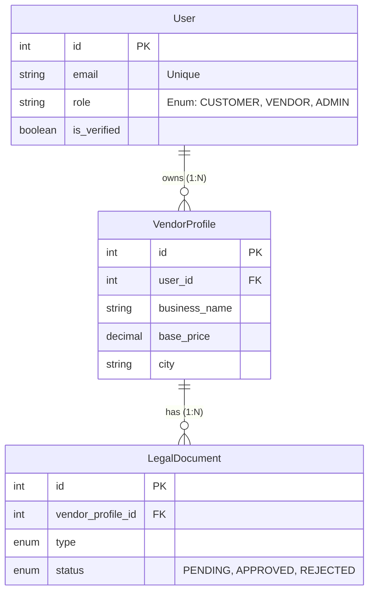
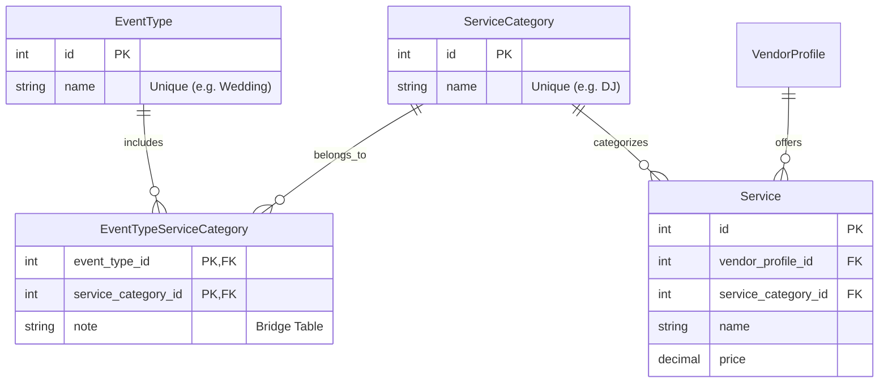
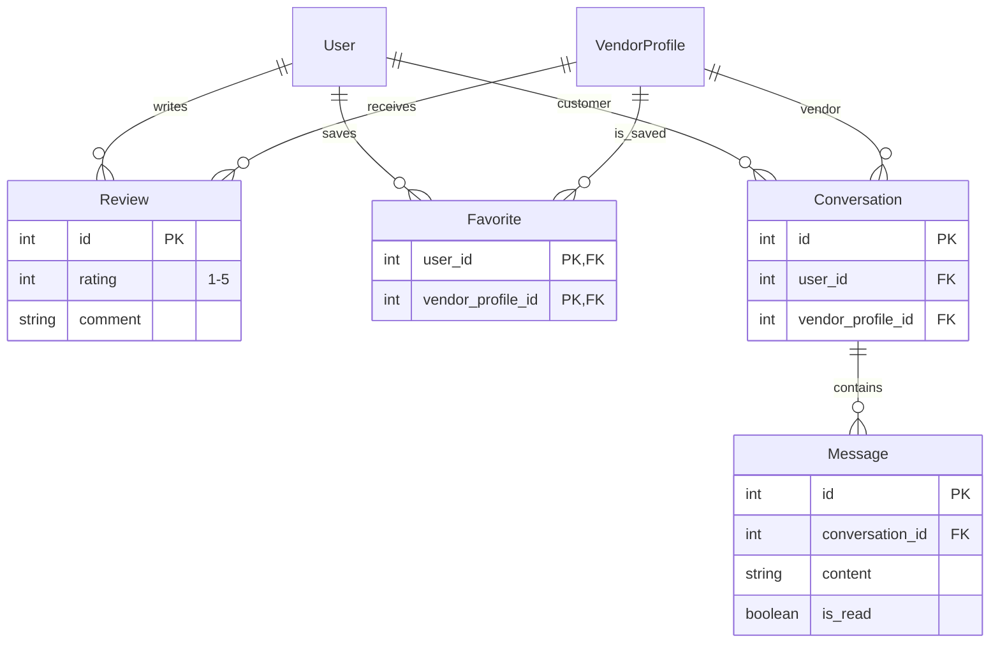

# Database Design Document - Event Marketplace App

## Part A: Conceptual ER Diagrams

To ensure better visibility, the system is visualized in three logical modules: **Accounts**, **Marketplace Hierarchy**, and **Engagement**.

### 1. Accounts & Profiles Module
*Focus: Users, Vendor Profiles, and Compliance.*

### 2. Marketplace & Search Module
*Focus: Categorization, Services, and the Bridge Table.*

### 3. Engagement Module (Social & Messaging)
*Focus: Reviews, Favorites, and Messaging.*

---

## Part B: Data Dictionary (Table Views)

### 1. User
*Central account entity for all roles.*

| Field | Type | Attributes | Description |
| :--- | :--- | :--- | :--- |
| `id` | Int | **PK**, Auto-inc | Unique identifier |
| `email` | String | **Unique** | User's email address |
| `passwordHash` | String | | Hashed password |
| `phone` | String | Nullable | Contact number |
| `role` | Enum | Default: `CUSTOMER` | `CUSTOMER`, `VENDOR`, `ADMIN` |
| `isVerified` | Boolean | Default: `false` | Email/Phone verification status |
| `createdAt` | DateTime | Default: `now()` | Timestamp of creation |

### 2. VendorProfile
*Business profile details. A user can own multiple profiles.*

| Field | Type | Attributes | Description |
| :--- | :--- | :--- | :--- |
| `id` | Int | **PK**, Auto-inc | Unique identifier |
| `userId` | Int | **FK** | Links to `User.id` (Owner) |
| `businessName` | String | | Display name of the business |
| `bio` | String | Text, Nullable | Detailed description |
| `basePrice` | Decimal | 10,2 Precision | Starting price for services |
| `portfolioImages` | String[] | Array | List of image URLs |
| `city` | String | | Operating city |
| `locationCoordinates` | Json | Nullable | `{lat, lng}` for map features |

### 3. LegalDocument
*Compliance documents for vendor verification.*

| Field | Type | Attributes | Description |
| :--- | :--- | :--- | :--- |
| `id` | Int | **PK**, Auto-inc | Unique identifier |
| `vendorProfileId` | Int | **FK** | Links to `VendorProfile.id` |
| `documentUrl` | String | | URL to the stored file |
| `type` | Enum | | `LICENSE`, `INSURANCE`, `GOVT_ID`, `OTHER` |
| `status` | Enum | Default: `PENDING` | `PENDING`, `APPROVED`, `REJECTED` |
| `rejectionReason` | String | Nullable | Admin feedback if rejected |

### 4. EventType
*High-level event classifications (e.g., Wedding).*

| Field | Type | Attributes | Description |
| :--- | :--- | :--- | :--- |
| `id` | Int | **PK**, Auto-inc | Unique identifier |
| `name` | String | **Unique** | Display name |
| `slug` | String | **Unique** | URL-friendly identifier |

### 5. ServiceCategory
*Specific service types (e.g., DJ, Catering).*

| Field | Type | Attributes | Description |
| :--- | :--- | :--- | :--- |
| `id` | Int | **PK**, Auto-inc | Unique identifier |
| `name` | String | **Unique** | Display name |
| `slug` | String | **Unique** | URL-friendly identifier |

### 6. EventTypeServiceCategory (Bridge Table)
*Maps which services are relevant for which events.*

| Field | Type | Attributes | Description |
| :--- | :--- | :--- | :--- |
| `eventTypeId` | Int | **PK, FK** | Links to `EventType.id` |
| `serviceCategoryId` | Int | **PK, FK** | Links to `ServiceCategory.id` |

### 7. Service
*Specific offering by a vendor under a category.*

| Field | Type | Attributes | Description |
| :--- | :--- | :--- | :--- |
| `id` | Int | **PK**, Auto-inc | Unique identifier |
| `vendorProfileId` | Int | **FK** | Links to `VendorProfile.id` |
| `serviceCategoryId` | Int | **FK** | Links to `ServiceCategory.id` |
| `name` | String | | Specific package name (e.g. "Gold Package") |
| `description` | String | Text, Nullable | Details of the service |
| `price` | Decimal | 10,2 Precision | Specific price for this service |

### 8. Review
*Ratings and comments.*

| Field | Type | Attributes | Description |
| :--- | :--- | :--- | :--- |
| `id` | Int | **PK**, Auto-inc | Unique identifier |
| `userId` | Int | **FK** | Author of the review |
| `vendorProfileId` | Int | **FK** | Recipient of the review |
| `rating` | Int | | 1-5 Star rating |
| `comment` | String | Text, Nullable | Written testimony |

### 9. Conversation
*Chat session container.*

| Field | Type | Attributes | Description |
| :--- | :--- | :--- | :--- |
| `id` | Int | **PK**, Auto-inc | Unique identifier |
| `userId` | Int | **FK** | The Customer |
| `vendorProfileId` | Int | **FK** | The Vendor Business |
| `updatedAt` | DateTime | | Used to sort inbox by recent activity |
| *Constraint* | | **Unique** | `[userId, vendorProfileId]` (One chat per pair) |

### 10. Message
*Individual chat messages.*

| Field | Type | Attributes | Description |
| :--- | :--- | :--- | :--- |
| `id` | Int | **PK**, Auto-inc | Unique identifier |
| `conversationId` | Int | **FK** | Parent conversation |
| `senderId` | Int | **FK** | User ID of the sender |
| `content` | String | Text | Message body |
| `isRead` | Boolean | Default: `false` | Read receipt status |

---

## Part C: Normalization & Logic Explanation

### 1. Vendor Profile Structure
**Decision:** Separated `User` and `VendorProfile` into two distinct tables with a One-to-Many relationship (`User` 1 -- * `VendorProfile`).
**Reasoning:** 
- **Multi-Profile Requirement:** The business logic explicitly states a single user (e.g., "Mike") can own multiple businesses (DJ and Photography). If we combined User and Vendor fields, Mike would need two separate accounts (two emails) to manage two businesses.
- **Separation of Concerns:** Authentication data (Email, Password, Phone) is distinct from Business data (Bio, Portfolio, Pricing). This allows a User to act as a Customer (hiring others) while also being a Vendor.

### 2. Messaging System
**Decision:** Implemented a `Conversation` model as a parent to `Message`s.
**Reasoning:**
- **Context:** A simple linear list of messages is hard to query for an "Inbox" view. Grouping messages into a `Conversation` (linked to a `User` and a `VendorProfile`) allows for an efficient "My Chats" list.
- **Linking:** The `Conversation` links a specific User (Customer) to a specific Vendor Profile. This ensures that if Mike has two businesses, the chat is clearly associated with the specific business profile the customer contacted, not just Mike's personal account.

### 3. Legal Documents Association
**Decision:** Associated `LegalDocument` with `VendorProfile`, not `User`.
**Reasoning:**
- **Granularity:** Compliance is usually business-specific. A photography business needs liability insurance, while a catering business needs health permits. Since one User can own both, the documents must be attached to the specific Profile to verify *that specific business*.
- **Status Tracking:** Each document has its own status (Pending/Approved/Rejected), allowing granular admin review.

### 4. Event & Service Hierarchy (Bridge Table)
**Decision:** Used a bridge table `EventTypeServiceCategory` (Implicit or Explicit in Prisma) to model the Many-to-Many relationship between `EventType` and `ServiceCategory`.
**Reasoning:**
- **Reusability:** A "DJ" category applies to "Weddings", "Birthdays", and "Corporate". A "Clown" category applies mainly to "Birthdays".
- **Filtering:** This structure allows efficient queries like "Show me all Service Categories relevant for a Wedding".

### 5. Services
**Decision:** Added a `Service` model linked to `VendorProfile` and `ServiceCategory`.
**Reasoning:**
- While the Vendor Profile has a "Base Price", most vendors offer specific packages or services (e.g., "Gold Wedding Package"). Linking these to a `ServiceCategory` allows for precise search filtering.
