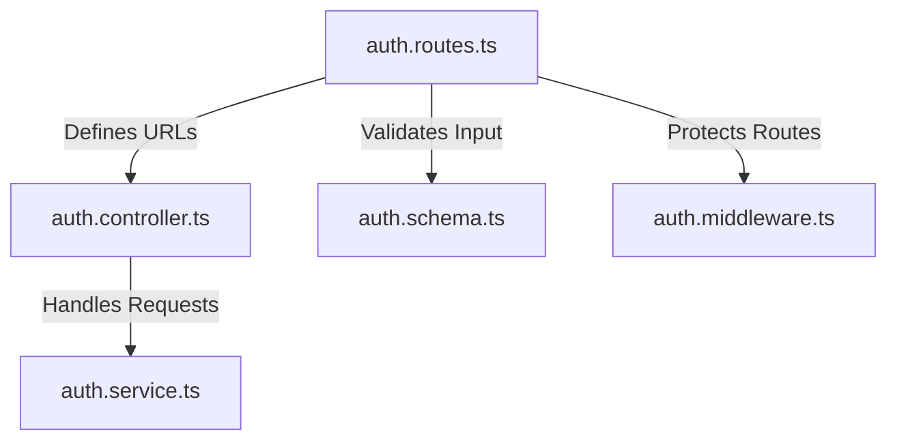
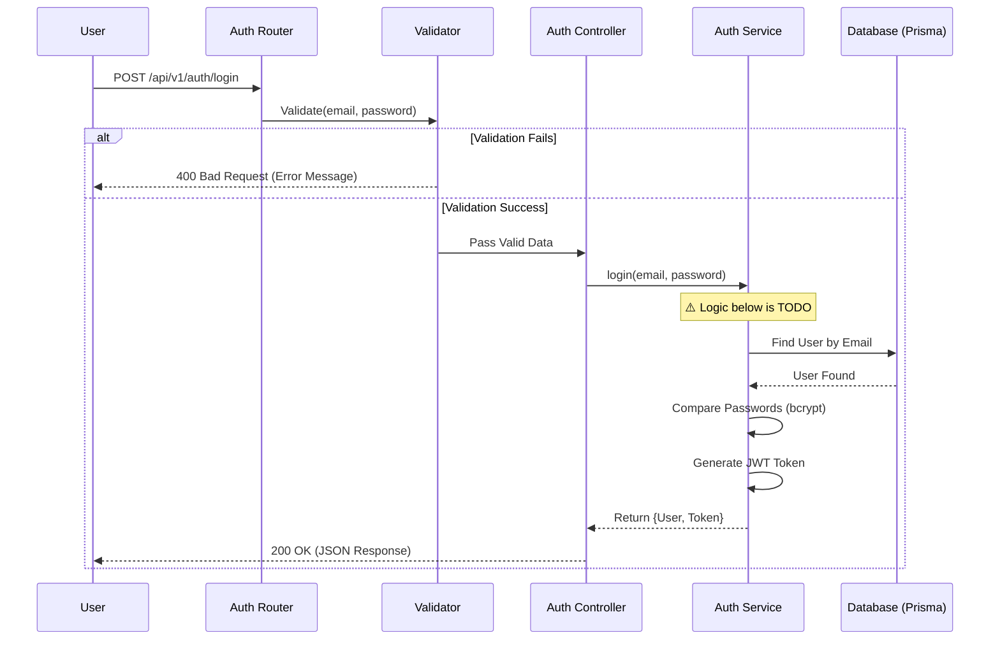

# Auth Module Implementation Guide

This document provides a beginner-friendly explanation of the Authentication Module in the backend application. It breaks down the files, their roles, and how they work together to handle user registration, login, and security.

## 1. Overview

The Auth module is responsible for managing user identity and access. It follows a structured **Controller-Service-Route** pattern, which is a common way to organize backend code to keep it clean and maintainable.

### 📂 File Structure



---

## 2. File Roles & Descriptions

Here is a breakdown of each file in `src/modules/auth` and related middlewares.

| File | Type | Role & Description |
|------|------|--------------------|
| **`auth.routes.ts`** | Router | **The Traffic Cop.** It lists all the available API endpoints (URLs) like `/login` or `/register`. It decides which controller function handles the request and applies any necessary checks (validation, security) beforehand. |
| **`auth.controller.ts`** | Controller | **The Waiter.** It receives the HTTP request from the user (Client), extracts user data (like email/password), calls the Service to do the work, and then sends the response back to the user. |
| **`auth.service.ts`** | Service | **The Chef.** It contains the "business logic". This is where the actual work happens: hashing passwords, checking specific rules, talking to the database (Prisma), and generating tokens. |
| **`auth.schema.ts`** | Schema | **The Bouncer.** It defines the rules for the data coming in. For example, "Email must be valid" or "Password must be at least 8 characters". Used to validate requests before they even reach the controller. |
| **`auth.middleware.ts`** | Middleware | **The Security Guard.** It checks if a user is allowed to access a route. It verifies the "Bearer Token" attached to requests to identify who the user is. |

---

## 3. Implementation Details

### A. The Routes (`auth.routes.ts`)

This file sets up the map for your API.

- **Public Routes**: accessible by anyone (e.g., Register, Login).
  - `POST /register`: Validates input -> Calls `controller.register`
  - `POST /login`: Validates input -> Calls `controller.login`
- **Protected Routes**: accessible only by logged-in users.
  - `POST /logout`: Checks Token (`protect`) -> Calls `controller.logout`
  - `GET /me`: Checks Token (`protect`) -> Calls `controller.getMe`

**Key Code Concept:**
```typescript
router.post('/login', validateRequest(loginSchema), authController.login);
```
*Translation:* "When a POST request comes to `/login`, first validate it against `loginSchema`. If valid, run `authController.login`."

### B. The Controller (`auth.controller.ts`)

These are simple functions that handle the "HTTP" part of the app.

- **Request Handling**: It grabs `req.body` (data sent by user).
- **Delegation**: It calls `authService.login(data)` to do the heavy lifting.
- **Response**: It uses helper functions like `sendSuccess` to format the JSON response sent back to the browser/app.

**Example Flow:**
```typescript
export const login = async (req, res) => {
    const data = req.body; // 1. Get data
    const result = await authService.login(data); // 2. Call Service
    sendSuccess(res, result); // 3. Send Response
};
```

### C. The Service (`auth.service.ts`)

 **⚠️ Current Status: Placeholder**

Currently, the service methods (`register`, `login`, etc.) are **placeholders**. They are set up to throw an error ("Not Implemented") to remind you to build the real logic.

**What needs to be implemented here?**
1.  **Register**:
    - Check if email is already taken in the database (`prisma.user.findUnique`).
    - Hash the password using a library like `bcrypt` (never save plain passwords!).
    - Save user to DB (`prisma.user.create`).
    - Generate a JWT (JSON Web Token).
2.  **Login**:
    - Find user by email.
    - Compare the input password with the hashed password in DB (`bcrypt.compare`).
    - Generate and return a JWT.

### D. The Schema (`auth.schema.ts`)

Uses a library called **Zod** to strictly define what data is allowed.

- **Start Simple**: Can just check for string types.
- **Get Specific**: Checks for valid email formats, password rules (1 uppercase, 1 number, etc.).
- **Why?** It prevents bad data from ever crashing your app logic.

### E. The Middleware (`auth.middleware.ts`)

**Role**: `protect` function.

1.  **Extracts Token**: Looks for `Authorization: Bearer <token>` header.
2.  **Verifies Token**: Checks if the token is valid (not expired, signed by this server).
3.  **Attaches User**: Finds the user associated with that token and attaches it to `req.user`.

**⚠️ Current Status: Placeholder**
The current `protect` middleware uses a **Mock User**. It accepts any token and pretends you are logged in as a specific user (`mock@example.com`).
*To go to production, you will need to uncomment the JWT verification logic provided in the code comments.*

---

## 4. Visual Flow

### Login Request Flow

This diagram shows what happens when a user clicks "Login".


