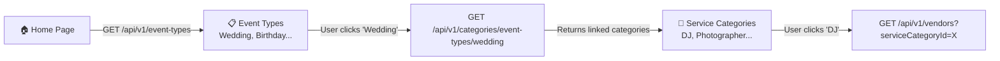

# EventType → ServiceCategory Browsing API

## Background

The app has an `EventTypeServiceCategory` bridge table connecting `EventType` ↔ `ServiceCategory`. The goal is to enable a **UI browsing flow**: User selects an EventType → sees the ServiceCategories available for that event → picks one to browse vendors.

### Current State

- `GET /api/v1/event-types` — ✅ Already lists all event types (public, paginated)
- `GET /api/v1/categories/event-types/:slug` — ❌ Stub (throws 501) — **this is what we need**
- `GET /api/v1/vendors?serviceCategoryId=X` — ✅ Already lists vendors by category

### UI Browsing Flow



## Proposed Changes

### Categories Module

#### [MODIFY] [category.service.ts](file:///d:/work/advert_app/backend/src/modules/categories/category.service.ts)

Implement `getEventTypeBySlug(slug)`:
- Query `EventType` by slug using Prisma
- Include linked service categories via the bridge table
- Flatten the bridge table shape → return `serviceCategories: [{ id, name, slug, imageUrl, vendorCount }]`
- Include `_count.vendorProfiles` per category (for UI: "12 vendors available")
- Throw 404 if slug not found

Leave `getAllEventTypes()`, `getAllServiceCategories()`, and `getServiceCategoryBySlug()` as 501 stubs for now.

#### [MODIFY] [category.controller.ts](file:///d:/work/advert_app/backend/src/modules/categories/category.controller.ts)

Update `getEventTypeBySlug` handler to call the now-implemented service method.

No changes to routes or schema — they're already correct.

## Verification Plan

### E2E Tests

#### [NEW] [category.test.ts](file:///d:/work/advert_app/backend/src/modules/categories/__tests__/category.test.ts)

| Test | Endpoint |
|---|---|
| Returns event type with linked service categories | `GET /api/v1/categories/event-types/:slug` |
| Includes `imageUrl` and `vendorCount` per category | `GET /api/v1/categories/event-types/:slug` |
| 404 for non-existent slug | `GET /api/v1/categories/event-types/non-existent` |
| Public — no auth required | `GET /api/v1/categories/event-types/:slug` |

```bash
npx jest --testPathPattern="categories/__tests__/category.test" --verbose --forceExit
```
