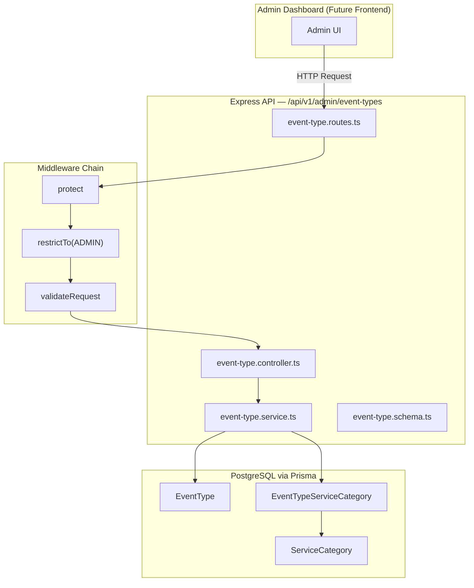
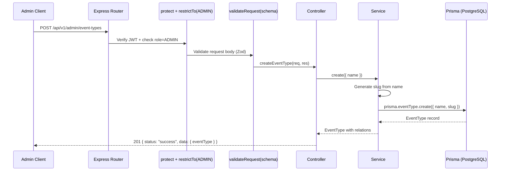

# EventType Admin Module — Implementation Plan

## Overview

The `EventType` model is a **core taxonomy entity** — it defines the types of events (e.g., *Wedding*, *Birthday*, *Corporate*) that the entire marketplace is organized around. Service categories (DJ, Photographer, Catering) are linked to event types via a many-to-many bridge table (`EventTypeServiceCategory`).

Currently, the existing `categories` module only exposes **read-only public routes** (list/get-by-slug). There is **no way for an admin to create, update, or delete** event types. This plan introduces a full **admin-managed CRUD module** for `EventType`, following professional patterns seen in platforms like Eventbrite, Meetup, and Airbnb Experiences.

---

## Architecture Overview



---

## Request Lifecycle

Shows how a single admin request flows through all layers:



---

## API Endpoints

All admin routes are **protected** (`protect` → `restrictTo('ADMIN')`).
The existing **public read routes** in the `categories` module remain unchanged.

| Method | Endpoint | Description | Auth |
|--------|----------|-------------|------|
| `POST` | `/api/v1/admin/event-types` | Create a new event type | Admin |
| `GET` | `/api/v1/admin/event-types` | List all event types (with pagination, search, sorting) | Admin |
| `GET` | `/api/v1/admin/event-types/:id` | Get a single event type by ID (with linked categories) | Admin |
| `PATCH` | `/api/v1/admin/event-types/:id` | Update event type name (slug auto-regenerates) and/or sync service categories | Admin |
| `DELETE` | `/api/v1/admin/event-types/:id` | Soft-check & delete an event type | Admin |
| `PUT` | `/api/v1/admin/event-types/:id/categories` | Sync linked service categories (set the M2M bridge) | Admin |

> [!NOTE]
> The public routes (`GET /api/v1/categories/event-types` and `GET /api/v1/categories/event-types/:slug`) remain in the existing `categories` module for customer-facing use. The admin module provides richer management capabilities with pagination, search, linked category management, and write operations.

---

## Request & Response Examples

### `POST /api/v1/admin/event-types` — Create

**Request Body:**
```json
{
  "name": "Wedding"
}
```

**Response (201):**
```json
{
  "status": "success",
  "message": "Event type created successfully",
  "data": {
    "eventType": {
      "id": 1,
      "name": "Wedding",
      "slug": "wedding",
      "serviceCategories": []
    }
  }
}
```

### `GET /api/v1/admin/event-types?page=1&limit=10&search=wed&sortBy=name&order=asc` — List

**Response (200):**
```json
{
  "status": "success",
  "data": {
    "eventTypes": [
      {
        "id": 1,
        "name": "Wedding",
        "slug": "wedding",
        "_count": { "serviceCategories": 3 }
      }
    ]
  },
  "meta": {
    "page": 1,
    "limit": 10,
    "total": 1,
    "totalPages": 1
  }
}
```

### `PUT /api/v1/admin/event-types/:id/categories` — Sync Categories

**Request Body:**
```json
{
  "serviceCategoryIds": [1, 3, 5]
}
```

**Response (200):**
```json
{
  "status": "success",
  "message": "Service categories synced successfully",
  "data": {
    "eventType": {
      "id": 1,
      "name": "Wedding",
      "slug": "wedding",
      "serviceCategories": [
        { "serviceCategory": { "id": 1, "name": "DJ", "slug": "dj" } },
        { "serviceCategory": { "id": 3, "name": "Catering", "slug": "catering" } },
        { "serviceCategory": { "id": 5, "name": "Photographer", "slug": "photographer" } }
      ]
    }
  }
}
```

---

## Proposed Changes

### New Module: `event-types` (Admin)

This module follows the established **4-file pattern** used across the codebase.

#### [NEW] [event-type.schema.ts](file:///d:/work/advert_app/backend/src/modules/event-types/event-type.schema.ts)

Zod validation schemas for all endpoints:

- **`createEventTypeSchema`** — `{ name: string }` (trimmed, 2-50 chars)
- **`updateEventTypeSchema`** — `{ name?: string }` (partial, same constraints)
- **`idParamSchema`** — `{ id: number }` (coerced integer, positive)
- **`listEventTypesQuerySchema`** — `{ page?, limit?, search?, sortBy?, order? }` (query params with defaults)
- **`syncCategoriesSchema`** — `{ serviceCategoryIds: number[] }` (array of positive integers)

---

#### [NEW] [event-type.service.ts](file:///d:/work/advert_app/backend/src/modules/event-types/event-type.service.ts)

Business logic layer with the `EventTypeService` class:

| Method | Description |
|--------|-------------|
| `create(name)` | Auto-generates slug, checks uniqueness, creates record |
| `findAll(query)` | Paginated list with `search` filter, sorting, and category counts |
| `findById(id)` | Single record with linked service categories |
| `update(id, data)` | Updates name, auto-regenerates slug, checks slug uniqueness |
| `delete(id)` | Checks bridge-table dependencies, prevents orphaning linked services, then deletes |
| `syncCategories(id, categoryIds)` | Replaces all M2M links via Prisma transaction — deletes old links, creates new ones |

**Slug generation** is handled by a private helper `generateSlug(name)`:
```
"Wedding DJ Party" → "wedding-dj-party"
```

---

#### [NEW] [event-type.controller.ts](file:///d:/work/advert_app/backend/src/modules/event-types/event-type.controller.ts)

Thin controller layer — extracts validated data from `req`, calls service, sends standardized response using existing `sendSuccess` / `sendCreated` / `sendNoContent` helpers.

---

#### [NEW] [event-type.routes.ts](file:///d:/work/advert_app/backend/src/modules/event-types/event-type.routes.ts)

Route definitions with middleware chain:

```typescript
// All routes: protect → restrictTo('ADMIN') → validateRequest → controller
router.post('/',       validateRequest(createSchema),              ctrl.create);
router.get('/',        validateRequest(listQuery, 'query'),        ctrl.getAll);
router.get('/:id',     validateRequest(idParam, 'params'),         ctrl.getOne);
router.patch('/:id',   validateRequest(idParam, 'params'),         ctrl.update);
router.delete('/:id',  validateRequest(idParam, 'params'),         ctrl.remove);
router.put('/:id/categories', validateRequest(syncSchema),         ctrl.syncCategories);
```

---

### App Registration

#### [MODIFY] [app.ts](file:///d:/work/advert_app/backend/src/app.ts)

- Import the new `eventTypeRoutes`
- Mount at `/api/v1/admin/event-types`

```diff
+import eventTypeRoutes from './modules/event-types/event-type.routes';

 // Mount Module Routes
 app.use('/api/v1/auth', authRoutes);
 ...
+app.use('/api/v1/admin/event-types', eventTypeRoutes);
```

---

## Design Decisions

| Decision | Rationale |
|----------|-----------|
| **Separate admin module** (not extending `categories`) | Keeps admin write-operations isolated from public read-only routes. Follows Separation of Concerns. Admin routes get distinct middleware. |
| **Auto-slug from name** | Admins don't need to think about URL-safe identifiers. Prevents inconsistencies. |
| **Sync pattern for M2M** (full-replace, not add/remove) | Simpler API surface — the frontend sends the desired state, backend reconciles. Used by Stripe, Shopify, and most admin panels. |
| **Pagination & search on list** | Essential for admin panels that grow — prevents loading thousands of records. |
| **Dependency check on delete** | Prevents orphaned bridge records; returns a clear error if the event type is in use. |
| **`/api/v1/admin/` prefix** | Creates a clear namespace for all future admin-only routes (e.g., `admin/service-categories`, `admin/users`). |

---

## Verification Plan

### Automated Tests

> [!NOTE]
> There are currently no automated tests in this project. Testing will be done via **manual API calls** using cURL or a REST client.

### Manual Verification

After implementation, the following steps can be verified:

1. **Start the dev server:** `npm run dev`
2. **Run Prisma migration** (if needed): `npx prisma db push`
3. **Create an admin user** — Using the existing auth flow, register a user and manually update their role to `ADMIN` in the database:
   ```sql
   UPDATE "User" SET role = 'ADMIN' WHERE email = 'admin@test.com';
   ```
4. **Login as admin** — `POST /api/v1/auth/login` to get access token + CSRF token
5. **Test each endpoint** using cURL or Postman:
   - `POST /api/v1/admin/event-types` with `{ "name": "Wedding" }` → expect 201
   - `GET /api/v1/admin/event-types` → expect paginated list
   - `GET /api/v1/admin/event-types/1` → expect single record with categories
   - `PATCH /api/v1/admin/event-types/1` with `{ "name": "Wedding Ceremony" }` → expect updated slug
   - `PUT /api/v1/admin/event-types/1/categories` with `{ "serviceCategoryIds": [1, 2] }` → expect synced
   - `DELETE /api/v1/admin/event-types/1` → expect 204
   - Attempt all routes **without auth** → expect 401
   - Attempt with **non-admin role** → expect 403
   - Attempt `POST` with **duplicate name** → expect 409
   - Attempt `POST` with **empty name** → expect 400

> [!IMPORTANT]
> Since this is the user's first admin module, the `/api/v1/admin/` prefix convention established here will serve as the pattern for all future admin routes (service-categories, user management, document approvals, etc.).
