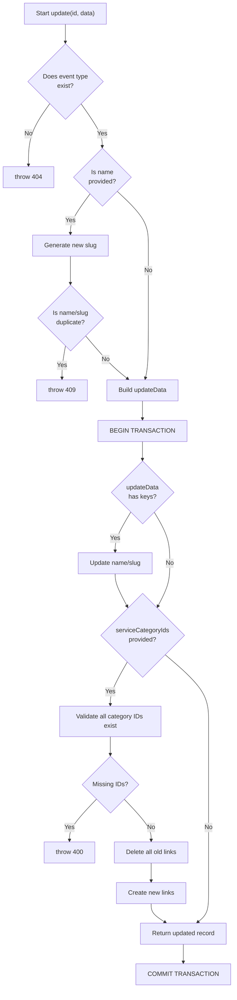
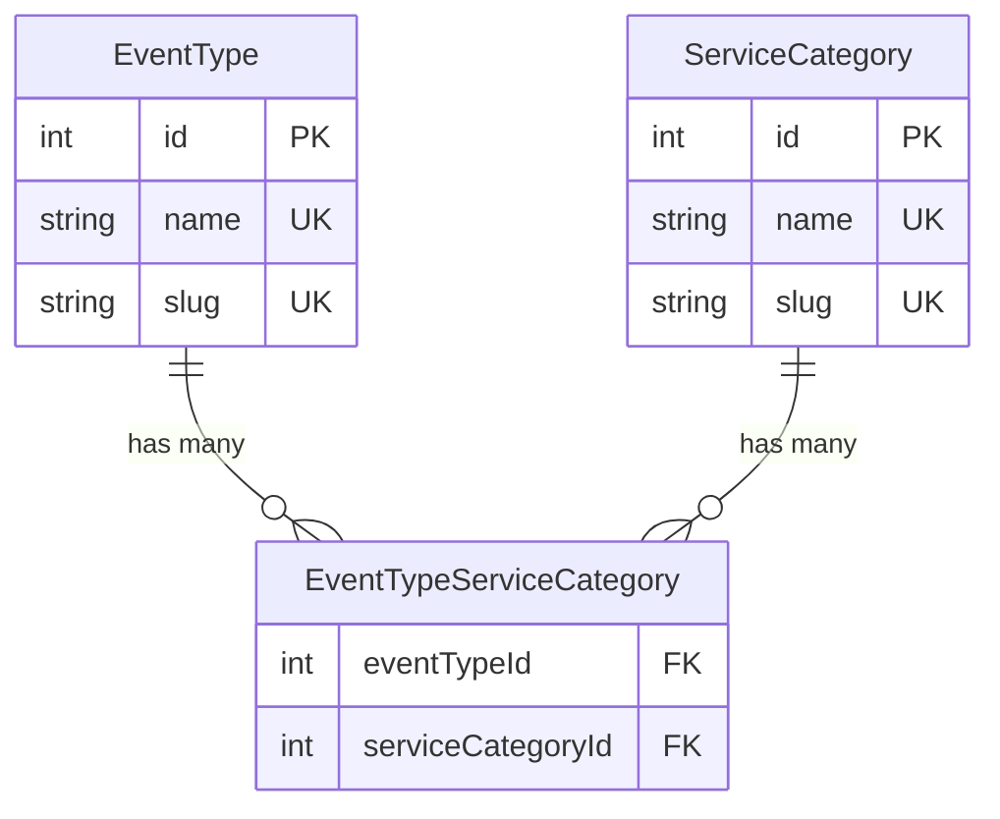
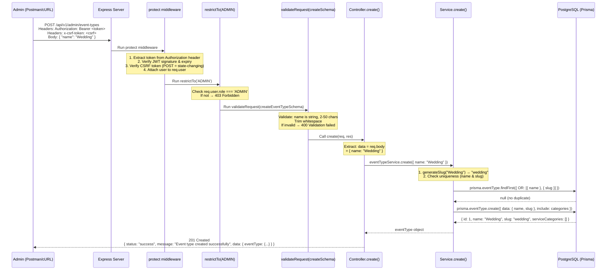

# EventType Admin Module — Detailed Explanation & Testing Guide

## Table of Contents

- [1. Module Overview](#1-module-overview)
- [2. How the Files Work Together](#2-how-the-files-work-together)
- [3. File-by-File Detailed Explanation](#3-file-by-file-detailed-explanation)
- [4. Database Models Involved](#4-database-models-involved)
- [5. Request Flow (Step-by-Step)](#5-request-flow-step-by-step)
- [6. Pre-Testing Setup](#6-pre-testing-setup)
- [7. Full Testing Guide (cURL Commands)](#7-full-testing-guide-curl-commands)
- [8. Error Scenarios & Expected Responses](#8-error-scenarios--expected-responses)
- [9. Testing Checklist](#9-testing-checklist)

---

## 1. Module Overview

The EventType Admin Module allows **ADMIN** users to manage event types (e.g., "Wedding", "Birthday", "Corporate") through a RESTful API. Event types are the top-level taxonomy that the entire marketplace is organized around.

### What It Does

| Capability | Description |
|------------|-------------|
| **Create** event types | Admin provides a name → system auto-generates a URL-safe slug |
| **List** event types | Paginated, searchable, sortable listing with category counts |
| **View** single event type | Returns full detail including all linked service categories |
| **Update** event types | Change name (slug regenerates) and/or link/unlink service categories |
| **Delete** event types | Cascades through bridge table, removes all category associations |
| **Sync categories** | Dedicated endpoint to set exactly which service categories are linked |

### API Endpoint Summary

All routes are under the base path: **`/api/v1/admin/event-types`**

| Method | Path | Action |
|--------|------|--------|
| `POST` | `/` | Create a new event type |
| `GET` | `/` | List all event types |
| `GET` | `/:id` | Get one event type by ID |
| `PATCH` | `/:id` | Update name and/or categories |
| `DELETE` | `/:id` | Delete an event type |
| `PUT` | `/:id/categories` | Sync linked service categories |

---

## 2. How the Files Work Together

```
📁 src/modules/event-types/
├── event-type.schema.ts      ← ① Defines validation rules (Zod)
├── event-type.routes.ts      ← ② Defines URL paths + middleware chain
├── event-type.controller.ts  ← ③ Handles HTTP request/response
└── event-type.service.ts     ← ④ Business logic + database operations
```

### Flow Diagram

```mermaid
flowchart LR
    A["Incoming HTTP Request"] --> B["event-type.routes.ts"]
    B -->|"1. protect middleware"| C["Verify JWT Token"]
    C -->|"2. restrictTo(ADMIN)"| D["Check user.role === ADMIN"]
    D -->|"3. validateRequest(schema)"| E["event-type.schema.ts<br/>Zod validates data"]
    E -->|"4. Call controller fn"| F["event-type.controller.ts<br/>Extract data, call service"]
    F -->|"5. Call service method"| G["event-type.service.ts<br/>Prisma DB operations"]
    G -->|"6. Return data"| F
    F -->|"7. Send JSON response"| A
```



**In plain English:**
1. A request arrives (e.g., `POST /api/v1/admin/event-types`)
2. **Routes** file catches it and runs middleware in sequence
3. **`protect`** middleware checks the JWT access token in the `Authorization` header
4. **`restrictTo('ADMIN')`** middleware checks that the authenticated user has role = `ADMIN`
5. **`validateRequest`** middleware runs the Zod schema against the request body/params/query
6. **Controller** function extracts the validated data and calls the appropriate **Service** method
7. **Service** does the actual Prisma database operation and returns the result
8. **Controller** sends the standardized JSON response back to the client

---

## 3. File-by-File Detailed Explanation

### 3.1 `event-type.schema.ts` — Validation Rules

This file defines **Zod schemas** — objects that describe what valid input looks like. If the input doesn't match, a `400 Validation failed` error is returned before any business logic runs.

#### Schemas Defined

| Schema | Used By | What It Validates |
|--------|---------|-------------------|
| `createEventTypeSchema` | `POST /` | Body must have `name` (string, 2-50 chars, auto-trimmed) |
| `updateEventTypeSchema` | `PATCH /:id` | Body may have `name` and/or `serviceCategoryIds`. At least one is required (enforced by `.refine()`) |
| `idParamSchema` | `GET/PATCH/DELETE /:id` | URL param `id` must be a positive integer (auto-coerced from string) |
| `listEventTypesQuerySchema` | `GET /` | Query params: `page` (default 1), `limit` (default 10, max 100), `search`, `sortBy` (name/id/slug), `order` (asc/desc) |
| `syncCategoriesSchema` | `PUT /:id/categories` | Body must have `serviceCategoryIds` as array of positive integers |

#### Key Design Decisions

**`z.coerce.number()`** on the `id` field:
URL parameters always arrive as strings (`"1"` not `1`). The `coerce` modifier automatically converts `"1"` → `1`.

**`.refine()` on `updateEventTypeSchema`**:
```typescript
.refine((data) => data.name !== undefined || data.serviceCategoryIds !== undefined, {
    message: 'At least one of "name" or "serviceCategoryIds" must be provided',
});
```
This prevents empty `PATCH` requests — the admin must provide **at least one** field to update. You can send just `name`, just `serviceCategoryIds`, or both.

---

### 3.2 `event-type.routes.ts` — URL Mapping & Middleware

This file connects **URL paths** to **controller functions** and applies **middleware**.

#### Router-Level Auth

```typescript
router.use(protect, restrictTo('ADMIN'));
```

This is applied once at the router level, so **every route** automatically requires:
1. A valid JWT access token (`protect`)
2. The user role to be `ADMIN` (`restrictTo('ADMIN')`)

This is cleaner than repeating `protect, restrictTo('ADMIN')` on every single route.

#### Dual Validation on PATCH

```typescript
router.patch(
    '/:id',
    validateRequest(idParamSchema, 'params'),   // Validate the :id param
    validateRequest(updateEventTypeSchema),       // Validate the request body
    eventTypeController.update
);
```

The `PATCH` route has **two** `validateRequest` calls — one for the URL parameter (`:id`) and one for the body. This is the pattern used when both params and body need validation.

#### Route Organization

Routes are organized into three logical groups:
- **Collection routes** (`POST /`, `GET /`) — operate on the entire collection
- **Single resource routes** (`GET /:id`, `PATCH /:id`, `DELETE /:id`) — operate on one item
- **Sub-resource routes** (`PUT /:id/categories`) — operate on a child relationship

---

### 3.3 `event-type.controller.ts` — Request Handlers

The controller is a **thin layer** — it does NOT contain business logic. Its only job is:

1. **Extract** validated data from `req.body`, `req.params`, or `req.query`
2. **Call** the appropriate service method
3. **Send** a standardized response

#### Response Helpers Used

| Helper | Status Code | When Used |
|--------|-------------|-----------|
| `sendCreated(res, data, message)` | `201 Created` | After creating a new event type |
| `sendSuccess(res, data, 200, message, meta)` | `200 OK` | For reads and updates |
| `sendNoContent(res)` | `204 No Content` | After successful deletion (no body) |

#### Example: The `update` Handler

```typescript
export const update = async (req: Request, res: Response): Promise<void> => {
    const { id } = req.params as unknown as IdParam;   // ← Extract validated ID
    const data = req.body as UpdateEventTypeInput;       // ← Extract validated body
    const eventType = await eventTypeService.update(id, data);  // ← Delegate to service
    sendSuccess(res, { eventType }, 200, 'Event type updated successfully');  // ← Response
};
```

---

### 3.4 `event-type.service.ts` — Business Logic & Database

This is the **core** of the module. It contains all Prisma queries, validation, and business rules.

#### Private Helpers

**`generateSlug(name)`** — Converts a human-readable name into a URL-safe slug:
```
"Wedding DJ Party"  →  "wedding-dj-party"
"Corporate  Event!" →  "corporate-event"
"  Birthday  "      →  "birthday"
```

Steps: lowercase → remove special chars → replace spaces with hyphens → collapse multiple hyphens → trim edges.

**`includeCategories` (getter)** — A reusable Prisma `include` clause that fetches linked service categories. Used across multiple methods to ensure consistent response shape.

#### Method-by-Method Breakdown

##### `create(data)`
1. Generate slug from `name`
2. Check if an event type with the same `name` OR `slug` already exists → `409 Conflict`
3. Insert into database with `prisma.eventType.create()`
4. Return the new record with its (empty) linked categories

##### `findAll(query)`
1. Destructure pagination/search/sort params from query
2. Build a `where` clause — searches by `name` OR `slug` (case-insensitive)
3. Run `count()` and `findMany()` **in parallel** using `Promise.all()` — this is a performance optimization
4. Return event types + pagination metadata (`page`, `limit`, `total`, `totalPages`)

##### `findById(id)`
1. Query by ID with linked categories included
2. If not found → `404 Not Found`
3. Return the record

##### `update(id, data)` — The Most Complex Method
This method uses a **Prisma transaction** to atomically perform up to 3 operations:



**Why a transaction?** If updating the name succeeds but syncing categories fails, we don't want a half-updated record. The transaction ensures all changes succeed or all roll back.

**Category sync within PATCH:**
- Send `serviceCategoryIds: [1, 3, 5]` → replaces all linked categories with exactly IDs 1, 3, 5
- Send `serviceCategoryIds: []` → removes ALL linked categories
- Omit `serviceCategoryIds` → categories are not touched

##### `delete(id)`
1. Check existence → `404` if not found
2. Use a transaction to:
   - Delete all rows in `EventTypeServiceCategory` bridge table where `eventTypeId = id`
   - Delete the `EventType` record itself
3. This prevents foreign key constraint violations

##### `syncCategories(id, serviceCategoryIds)`
Dedicated endpoint for full-replace sync:
1. Verify event type exists
2. Validate every ID in `serviceCategoryIds` exists in `ServiceCategory` table
3. Transaction: delete all old bridge rows → create new bridge rows
4. Return updated event type with new category links

---

## 4. Database Models Involved



- **EventType** — The entity this module manages
- **ServiceCategory** — Referenced when linking categories (managed separately)
- **EventTypeServiceCategory** — The **bridge/junction table** enabling the many-to-many relationship

---

## 5. Request Flow (Step-by-Step)

Here is an example of what happens when an admin creates a new event type:

### Example: `POST /api/v1/admin/event-types` with `{ "name": "Wedding" }`



---

## 6. Pre-Testing Setup

### Step 1: Ensure Database Is Synced

```bash
npx prisma db push
```

This pushes your Prisma schema to the database. If you haven't created the tables yet, this will create them.

### Step 2: Start the Dev Server

```bash
npm run dev
```

You should see output like:
```
🚀 Server listening on port 5000 in development mode
```

### Step 3: Create a Test Admin User

First, register a normal user:

```bash
curl -X POST http://localhost:5000/api/v1/auth/register \
  -H "Content-Type: application/json" \
  -d '{
    "email": "admin@test.com",
    "password": "Admin123!@#",
    "displayName": "Test Admin"
  }'
```

Then promote them to ADMIN directly in the database:

```sql
UPDATE "User" SET role = 'ADMIN' WHERE email = 'admin@test.com';
```

> **Note:** If you already have email verification enabled, you may also need to:
> ```sql
> UPDATE "User" SET "isVerified" = true WHERE email = 'admin@test.com';
> ```

### Step 4: Login and Get Tokens

```bash
curl -X POST http://localhost:5000/api/v1/auth/login \
  -H "Content-Type: application/json" \
  -d '{
    "email": "admin@test.com",
    "password": "Admin123!@#"
  }' \
  -c cookies.txt
```

From the response, note:
- **`accessToken`** — Used in the `Authorization: Bearer <token>` header
- **`csrfToken`** — Used in the `x-csrf-token` header (required for POST/PATCH/PUT/DELETE)

### Step 5: Set Up Shell Variables

For convenience in cURL commands, export these:

```bash
# Replace with actual tokens from the login response
export TOKEN="your_access_token_here"
export CSRF="your_csrf_token_here"
export BASE="http://localhost:5000/api/v1/admin/event-types"
```

---

## 7. Full Testing Guide (cURL Commands)

### Test 1: Create an Event Type

```bash
curl -X POST $BASE \
  -H "Content-Type: application/json" \
  -H "Authorization: Bearer $TOKEN" \
  -H "x-csrf-token: $CSRF" \
  -d '{ "name": "Wedding" }'
```

**Expected Response (201):**
```json
{
  "status": "success",
  "message": "Event type created successfully",
  "data": {
    "eventType": {
      "id": 1,
      "name": "Wedding",
      "slug": "wedding",
      "serviceCategories": []
    }
  }
}
```

**What to verify:**
- Status code is `201`
- `slug` is auto-generated as `"wedding"`
- `serviceCategories` is an empty array

---

### Test 2: Create More Event Types (for testing list)

```bash
curl -X POST $BASE \
  -H "Content-Type: application/json" \
  -H "Authorization: Bearer $TOKEN" \
  -H "x-csrf-token: $CSRF" \
  -d '{ "name": "Birthday Party" }'
```

```bash
curl -X POST $BASE \
  -H "Content-Type: application/json" \
  -H "Authorization: Bearer $TOKEN" \
  -H "x-csrf-token: $CSRF" \
  -d '{ "name": "Corporate Event" }'
```

```bash
curl -X POST $BASE \
  -H "Content-Type: application/json" \
  -H "Authorization: Bearer $TOKEN" \
  -H "x-csrf-token: $CSRF" \
  -d '{ "name": "Concert" }'
```

---

### Test 3: List All Event Types (Default Pagination)

```bash
curl -X GET "$BASE" \
  -H "Authorization: Bearer $TOKEN"
```

**Expected Response (200):**
```json
{
  "status": "success",
  "data": {
    "eventTypes": [
      { "id": 4, "name": "Birthday Party", "slug": "birthday-party", "_count": { "serviceCategories": 0 }, "serviceCategories": [] },
      { "id": 3, "name": "Concert", "slug": "concert", "_count": { "serviceCategories": 0 }, "serviceCategories": [] },
      { "id": 2, "name": "Corporate Event", "slug": "corporate-event", "_count": { "serviceCategories": 0 }, "serviceCategories": [] },
      { "id": 1, "name": "Wedding", "slug": "wedding", "_count": { "serviceCategories": 0 }, "serviceCategories": [] }
    ]
  },
  "meta": {
    "page": 1,
    "limit": 10,
    "total": 4,
    "totalPages": 1
  }
}
```

**What to verify:**
- Default sort is by `name` ascending (alphabetical)
- `meta` object includes pagination info
- `_count` shows number of linked categories

---

### Test 4: List with Search

```bash
curl -X GET "$BASE?search=wed" \
  -H "Authorization: Bearer $TOKEN"
```

**Expected:** Only "Wedding" is returned (matches `name` containing "wed").

---

### Test 5: List with Pagination

```bash
curl -X GET "$BASE?page=1&limit=2" \
  -H "Authorization: Bearer $TOKEN"
```

**Expected:** Only 2 items in `eventTypes`, `meta.totalPages` = 2.

---

### Test 6: List with Sort (descending)

```bash
curl -X GET "$BASE?sortBy=name&order=desc" \
  -H "Authorization: Bearer $TOKEN"
```

**Expected:** Event types sorted Z→A (Wedding first, Birthday Party last).

---

### Test 7: Get Single Event Type

```bash
curl -X GET "$BASE/1" \
  -H "Authorization: Bearer $TOKEN"
```

**Expected Response (200):**
```json
{
  "status": "success",
  "data": {
    "eventType": {
      "id": 1,
      "name": "Wedding",
      "slug": "wedding",
      "serviceCategories": []
    }
  }
}
```

---

### Test 8: Update Name Only

```bash
curl -X PATCH "$BASE/1" \
  -H "Content-Type: application/json" \
  -H "Authorization: Bearer $TOKEN" \
  -H "x-csrf-token: $CSRF" \
  -d '{ "name": "Wedding Ceremony" }'
```

**Expected Response (200):**
```json
{
  "status": "success",
  "message": "Event type updated successfully",
  "data": {
    "eventType": {
      "id": 1,
      "name": "Wedding Ceremony",
      "slug": "wedding-ceremony",
      "serviceCategories": []
    }
  }
}
```

**What to verify:**
- `slug` auto-regenerated from `"wedding"` → `"wedding-ceremony"`
- `serviceCategories` unchanged (was empty, still empty)

---

### Test 9: Update with Service Categories (via PATCH)

> **Prerequisite:** You need existing `ServiceCategory` records. If you don't have any, create them manually:
> ```sql
> INSERT INTO "ServiceCategory" (name, slug) VALUES ('DJ', 'dj');
> INSERT INTO "ServiceCategory" (name, slug) VALUES ('Photographer', 'photographer');
> INSERT INTO "ServiceCategory" (name, slug) VALUES ('Catering', 'catering');
> ```

```bash
curl -X PATCH "$BASE/1" \
  -H "Content-Type: application/json" \
  -H "Authorization: Bearer $TOKEN" \
  -H "x-csrf-token: $CSRF" \
  -d '{ "serviceCategoryIds": [1, 2, 3] }'
```

**Expected Response (200):**
```json
{
  "status": "success",
  "message": "Event type updated successfully",
  "data": {
    "eventType": {
      "id": 1,
      "name": "Wedding Ceremony",
      "slug": "wedding-ceremony",
      "serviceCategories": [
        { "eventTypeId": 1, "serviceCategoryId": 1, "serviceCategory": { "id": 1, "name": "DJ", "slug": "dj" } },
        { "eventTypeId": 1, "serviceCategoryId": 2, "serviceCategory": { "id": 2, "name": "Photographer", "slug": "photographer" } },
        { "eventTypeId": 1, "serviceCategoryId": 3, "serviceCategory": { "id": 3, "name": "Catering", "slug": "catering" } }
      ]
    }
  }
}
```

**What to verify:**
- Name unchanged (we didn't send `name`)
- 3 categories are now linked

---

### Test 10: Update Name AND Reduce Categories (Single Request)

```bash
curl -X PATCH "$BASE/1" \
  -H "Content-Type: application/json" \
  -H "Authorization: Bearer $TOKEN" \
  -H "x-csrf-token: $CSRF" \
  -d '{
    "name": "Wedding",
    "serviceCategoryIds": [1]
  }'
```

**Expected:**
- Name changed back to `"Wedding"`, slug to `"wedding"`
- Only category ID 1 (DJ) remains linked — categories 2 and 3 are **removed**

---

### Test 11: Remove ALL Categories

```bash
curl -X PATCH "$BASE/1" \
  -H "Content-Type: application/json" \
  -H "Authorization: Bearer $TOKEN" \
  -H "x-csrf-token: $CSRF" \
  -d '{ "serviceCategoryIds": [] }'
```

**Expected:** `serviceCategories` is now an empty array `[]`.

---

### Test 12: Sync Categories (PUT endpoint)

```bash
curl -X PUT "$BASE/1/categories" \
  -H "Content-Type: application/json" \
  -H "Authorization: Bearer $TOKEN" \
  -H "x-csrf-token: $CSRF" \
  -d '{ "serviceCategoryIds": [2, 3] }'
```

**Expected:** Event type 1 now has exactly categories 2 (Photographer) and 3 (Catering).

---

### Test 13: Delete an Event Type

```bash
curl -X DELETE "$BASE/4" \
  -H "Authorization: Bearer $TOKEN" \
  -H "x-csrf-token: $CSRF"
```

**Expected Response:** `204 No Content` (empty body).

**Verify:** `GET /api/v1/admin/event-types/4` should now return `404`.

---

## 8. Error Scenarios & Expected Responses

### 8.1 Authentication Errors

#### No Token Provided
```bash
curl -X GET $BASE
```
**Expected (401):**
```json
{
  "status": "fail",
  "message": "You are not logged in. Please log in to access this resource."
}
```

#### Invalid/Expired Token
```bash
curl -X GET $BASE -H "Authorization: Bearer invalid_token"
```
**Expected (401):**
```json
{
  "status": "fail",
  "message": "Invalid authentication token."
}
```

---

### 8.2 Authorization Errors

#### Non-Admin User Tries to Access
Login as a `CUSTOMER` user and attempt:
```bash
curl -X GET $BASE -H "Authorization: Bearer $CUSTOMER_TOKEN"
```
**Expected (403):**
```json
{
  "status": "fail",
  "message": "You do not have permission to perform this action."
}
```

---

### 8.3 Missing CSRF Token (on state-changing requests)

```bash
curl -X POST $BASE \
  -H "Content-Type: application/json" \
  -H "Authorization: Bearer $TOKEN" \
  -d '{ "name": "Test" }'
```
**Expected (403):**
```json
{
  "status": "fail",
  "message": "CSRF token is required for this request."
}
```

> **Note:** GET requests do NOT require a CSRF token — only POST, PATCH, PUT, DELETE.

---

### 8.4 Validation Errors

#### Empty Name
```bash
curl -X POST $BASE \
  -H "Content-Type: application/json" \
  -H "Authorization: Bearer $TOKEN" \
  -H "x-csrf-token: $CSRF" \
  -d '{ "name": "" }'
```
**Expected (400):**
```json
{
  "status": "fail",
  "message": "Validation failed: name: Name must be at least 2 characters"
}
```

#### Name Too Short
```bash
curl -X POST $BASE \
  -H "Content-Type: application/json" \
  -H "Authorization: Bearer $TOKEN" \
  -H "x-csrf-token: $CSRF" \
  -d '{ "name": "A" }'
```
**Expected (400):** `"Name must be at least 2 characters"`

#### Empty PATCH Body
```bash
curl -X PATCH "$BASE/1" \
  -H "Content-Type: application/json" \
  -H "Authorization: Bearer $TOKEN" \
  -H "x-csrf-token: $CSRF" \
  -d '{}'
```
**Expected (400):** `"At least one of "name" or "serviceCategoryIds" must be provided"`

#### Invalid ID (string instead of number)
```bash
curl -X GET "$BASE/abc" -H "Authorization: Bearer $TOKEN"
```
**Expected (400):** Validation error on `id` parameter.

#### Negative / Zero ID
```bash
curl -X GET "$BASE/0" -H "Authorization: Bearer $TOKEN"
```
**Expected (400):** `"ID must be a positive integer"`

---

### 8.5 Business Logic Errors

#### Duplicate Event Type Name
```bash
# Assuming "Wedding" already exists
curl -X POST $BASE \
  -H "Content-Type: application/json" \
  -H "Authorization: Bearer $TOKEN" \
  -H "x-csrf-token: $CSRF" \
  -d '{ "name": "Wedding" }'
```
**Expected (409):**
```json
{
  "status": "fail",
  "message": "An event type with this name already exists: \"Wedding\""
}
```

#### Non-Existent Event Type
```bash
curl -X GET "$BASE/9999" -H "Authorization: Bearer $TOKEN"
```
**Expected (404):**
```json
{
  "status": "fail",
  "message": "Event type with ID 9999 not found"
}
```

#### Non-Existent Service Category IDs
```bash
curl -X PUT "$BASE/1/categories" \
  -H "Content-Type: application/json" \
  -H "Authorization: Bearer $TOKEN" \
  -H "x-csrf-token: $CSRF" \
  -d '{ "serviceCategoryIds": [999, 888] }'
```
**Expected (400):**
```json
{
  "status": "fail",
  "message": "Service categories not found: 999, 888"
}
```

---

## 9. Testing Checklist

Use this checklist to verify all functionality:

### CRUD Operations
- [ ] **Create** — `POST /` with valid name → 201 + auto-slug
- [ ] **Create** — Verify slug generation (spaces → hyphens, lowercase)
- [ ] **List** — `GET /` default → 200 + all records
- [ ] **List** — With `?search=` → filtered results
- [ ] **List** — With `?page=1&limit=2` → correct pagination
- [ ] **List** — With `?sortBy=name&order=desc` → reverse alphabetical
- [ ] **Get One** — `GET /:id` with valid ID → 200 + full record + categories
- [ ] **Update Name** — `PATCH /:id` with `{ name }` → slug regenerates
- [ ] **Update Categories** — `PATCH /:id` with `{ serviceCategoryIds }` → categories synced
- [ ] **Update Both** — `PATCH /:id` with `{ name, serviceCategoryIds }` → both updated
- [ ] **Remove All Categories** — `PATCH /:id` with `{ serviceCategoryIds: [] }` → cleared
- [ ] **Sync Categories** — `PUT /:id/categories` → full-replace
- [ ] **Delete** — `DELETE /:id` → 204 No Content

### Security
- [ ] No token → 401
- [ ] Invalid token → 401
- [ ] Expired token → 401
- [ ] Non-admin role → 403
- [ ] Missing CSRF on POST → 403
- [ ] Missing CSRF on PATCH → 403
- [ ] Missing CSRF on DELETE → 403
- [ ] GET requests work WITHOUT CSRF → ✅

### Validation
- [ ] Empty name → 400
- [ ] Name too short (1 char) → 400
- [ ] Name too long (51+ chars) → 400
- [ ] Empty PATCH body → 400
- [ ] Invalid ID format → 400
- [ ] Negative ID → 400

### Business Logic
- [ ] Duplicate name on create → 409
- [ ] Duplicate name on update → 409
- [ ] Non-existent ID on get → 404
- [ ] Non-existent ID on update → 404
- [ ] Non-existent ID on delete → 404
- [ ] Invalid service category IDs → 400
