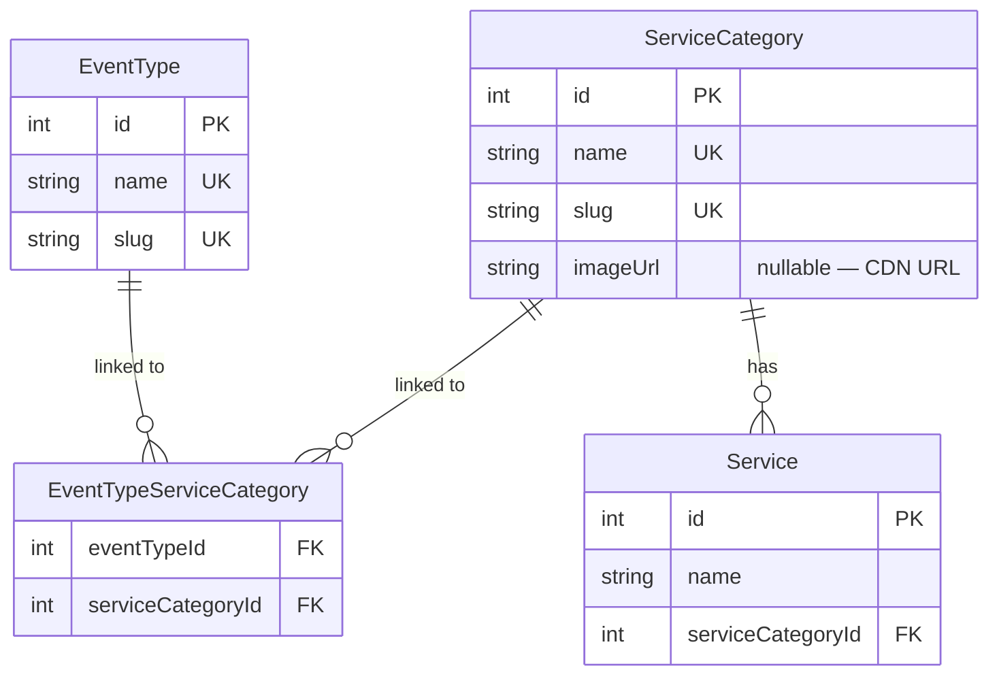
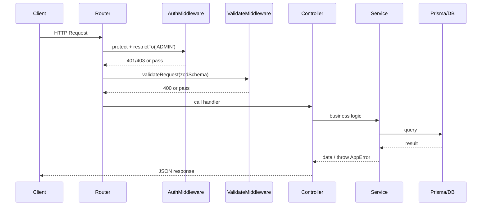
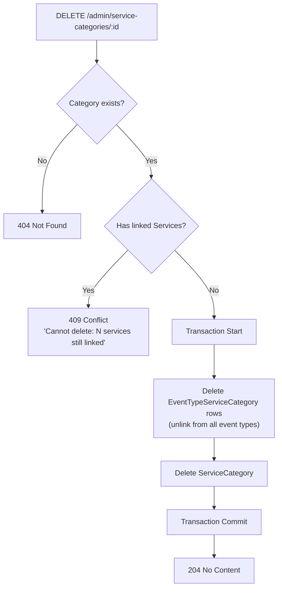

# ServiceCategory Admin Module — Implementation Plan

## Overview

Build an admin-only CRUD module for managing **ServiceCategories** (e.g. "DJ", "Photographer", "Catering"). Each category can be linked to multiple EventTypes and carries an **image URL** so the frontend can display a visual card when users browse categories under a specific event type.

The module follows the established **4-file pattern** (`schema → service → controller → routes`) and mirrors the existing `event-types` admin module.

---

## Design Decisions

| # | Decision | Rationale |
|---|----------|-----------|
| 1 | **imageUrl is a URL string** stored in the DB | Admin provides a pre-hosted URL (e.g. CDN). No file upload middleware (multer) is needed for this task. |
| 2 | **Deletion is blocked** when Services exist | Prevents orphaning vendor data. Admin must reassign or remove Services before deleting a category. |
| 3 | **Cascade delete only on bridge table** | `EventTypeServiceCategory` rows are cleaned up automatically — the category is simply unlinked from event types. |
| 4 | **eventTypeId query filter** on LIST endpoint | When the frontend sends `?eventTypeId=N`, the backend uses Prisma's `some` operator on the M2M bridge table to return only categories linked to that event type. |

---

## Data Model



---

## Request Flow



---

## Delete Flow (with Service Guard)



---

## Proposed Changes

### 1. Prisma Schema Migration

#### [MODIFY] [schema.prisma](file:///d:/work/advert_app/backend/prisma/schema.prisma)

Add `imageUrl` field to `ServiceCategory`:

```diff
 model ServiceCategory {
   id   Int    @id @default(autoincrement())
   name String @unique
   slug String @unique
+  imageUrl String?   // URL to category image (e.g. CDN link)

   eventTypes EventTypeServiceCategory[]
   services   Service[]
 }
```

Then run:
```bash
npx prisma migrate dev --name add-service-category-image-url
```

---

### 2. Service-Categories Admin Module (4 new files)

#### [NEW] [service-category.schema.ts](file:///d:/work/advert_app/backend/src/modules/service-categories/service-category.schema.ts)

Zod validation schemas:

| Schema | Purpose | Fields |
|---|---|---|
| `createServiceCategorySchema` | POST body | `name` (2–50 chars, required), `imageUrl` (valid URL, optional) |
| `updateServiceCategorySchema` | PATCH body | `name` (optional), `imageUrl` (optional or `null` to clear), at least one required |
| `idParamSchema` | `:id` param | `id` (positive integer, coerced from string) |
| `listServiceCategoriesQuerySchema` | GET query | `page` (default 1), `limit` (default 10, max 100), `search`, `eventTypeId` (optional positive int — filter by linked event type), `sortBy` (name/id/slug, default name), `order` (asc/desc, default asc) |

---

#### [NEW] [service-category.service.ts](file:///d:/work/advert_app/backend/src/modules/service-categories/service-category.service.ts)

`ServiceCategoryService` class:

| Method | Logic |
|---|---|
| `create(data)` | Generate slug from name → check uniqueness (name + slug) → `prisma.serviceCategory.create()` with imageUrl → return with linked event types |
| `findAll(query)` | Build `where` clause: search (name OR slug contains) + optional `eventTypeId` filter via `eventTypes: { some: { eventTypeId } }` → `prisma.serviceCategory.findMany()` with pagination, sort, include counts → return `{ serviceCategories, meta }` |
| `findById(id)` | `prisma.serviceCategory.findUnique()` with include event types → 404 if not found |
| `update(id, data)` | Check exists (404) → if name changed, generate new slug, check uniqueness (409) → update name/slug/imageUrl → return updated |
| `delete(id)` | Check exists (404) → check `services` count → if > 0, throw 409 "Cannot delete: N services still linked" → transaction: delete bridge rows → delete category → 204 |

Slug generation helper (same as event-types): lowercase, trim, strip specials, hyphens.

---

#### [NEW] [service-category.controller.ts](file:///d:/work/advert_app/backend/src/modules/service-categories/service-category.controller.ts)

5 thin controller handlers — delegate to service, use `sendSuccess`/`sendCreated`/`sendNoContent`:

| Handler | Route | Status Code |
|---|---|---|
| `create` | `POST /` | 201 |
| `getAll` | `GET /` | 200 + meta |
| `getOne` | `GET /:id` | 200 |
| `update` | `PATCH /:id` | 200 |
| `remove` | `DELETE /:id` | 204 |

---

#### [NEW] [service-category.routes.ts](file:///d:/work/advert_app/backend/src/modules/service-categories/service-category.routes.ts)

All routes protected: `router.use(protect, restrictTo('ADMIN'))`.

| Method | Path | Middleware |
|---|---|---|
| `POST` | `/` | `validateRequest(createSchema)` |
| `GET` | `/` | `validateRequest(listQuerySchema, 'query')` |
| `GET` | `/:id` | `validateRequest(idParamSchema, 'params')` |
| `PATCH` | `/:id` | `validateRequest(idParamSchema, 'params')` + `validateRequest(updateSchema)` |
| `DELETE` | `/:id` | `validateRequest(idParamSchema, 'params')` |

---

### 3. App Integration

#### [MODIFY] [app.ts](file:///d:/work/advert_app/backend/src/app.ts)

```diff
 import eventTypeRoutes from './modules/event-types/event-type.routes';
+import serviceCategoryRoutes from './modules/service-categories/service-category.routes';

 // Admin Module Routes
 app.use('/api/v1/admin/event-types', eventTypeRoutes);
+app.use('/api/v1/admin/service-categories', serviceCategoryRoutes);
```

---

## Route Summary

| # | Method | Full Path | Description | Auth |
|---|---|---|---|---|
| 1 | `POST` | `/api/v1/admin/service-categories` | Create a service category | Admin + CSRF |
| 2 | `GET` | `/api/v1/admin/service-categories` | List all (paginated, searchable, filterable by `?eventTypeId=N`) | Admin |
| 3 | `GET` | `/api/v1/admin/service-categories/:id` | Get one by ID | Admin |
| 4 | `PATCH` | `/api/v1/admin/service-categories/:id` | Update name and/or imageUrl | Admin + CSRF |
| 5 | `DELETE` | `/api/v1/admin/service-categories/:id` | Delete (blocked if services exist) | Admin + CSRF |

---

## Verification Plan

### Build Check
```bash
npx tsc --noEmit
```

### E2E Tests

Test file: `src/modules/service-categories/__tests__/service-category.test.ts`

**Test groups** (~30 tests):
1. **Auth Guard** — 401/403 for missing token, wrong role, missing CSRF
2. **POST (Create)** — happy path, duplicate name, validation errors, imageUrl
3. **GET (List)** — pagination, search, sort
4. **GET (Get One)** — happy path, 404, invalid ID
5. **PATCH (Update)** — name update, imageUrl update, clear imageUrl, both, validation errors, 404, duplicate name
6. **DELETE (Remove)** — happy path w/ cascade bridge cleanup, blocked when services exist, 404

**Command:**
```bash
npx cross-env NODE_ENV=test npx jest --detectOpenHandles --testPathPatterns="service-category" --verbose
```
