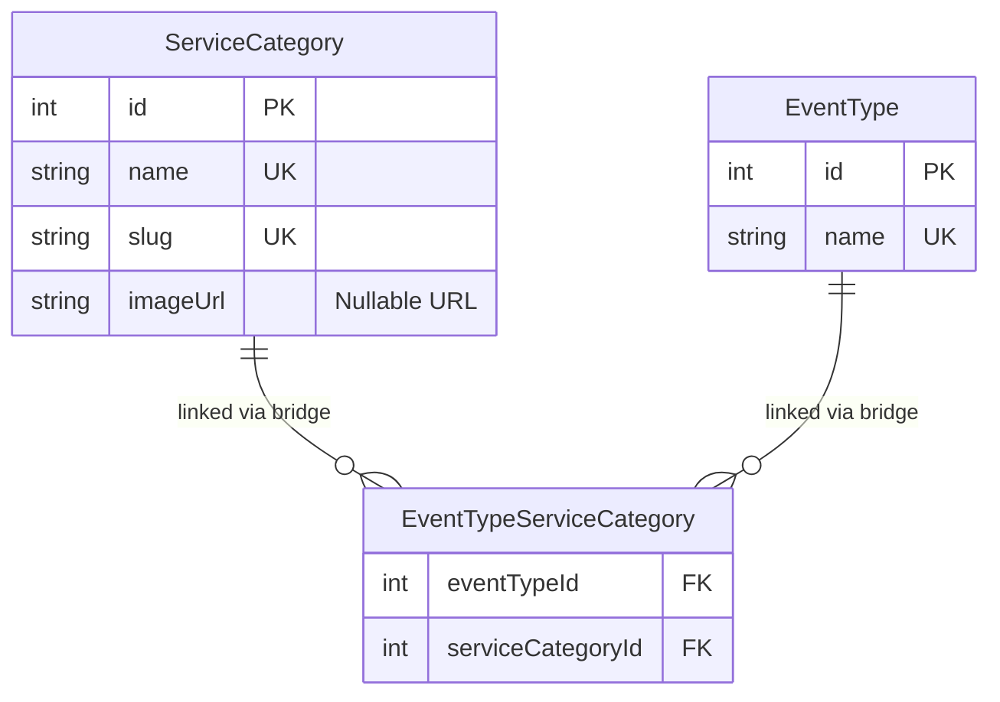
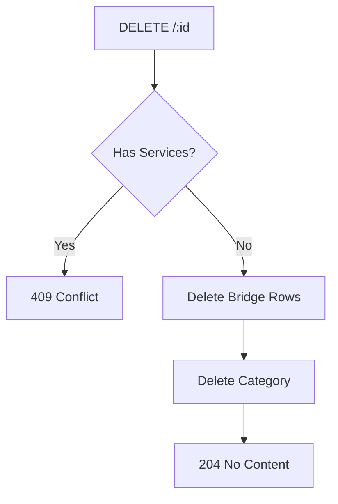

# ServiceCategory Admin Module — Implementation Report

## 1. Summary

The **ServiceCategory Admin Module** has been successfully implemented, providing full CRUD capabilities for managing service categories. It includes:
- **Database Schema**: Updated `ServiceCategory` model with `imageUrl`, verified with Prisma migration.
- **API Endpoints**: 5 admin-protected endpoints following REST standards.
- **Validation**: Strict input validation using Zod schemas for all requests.
- **Safety**: Guarded deletion prevents removing categories that are still in use by Services.
- **Filtering**: `GET /` endpoint supports filtering by `eventTypeId`.

---

## 2. Data Model

The implementation follows the approved schema design:



---

## 3. Delete Guard Logic

To prevent data inconsistency, deletion has a specific guard logic:
1. **Check**: Does this category satisfy any `Services`?
   - **Yes**: Block deletion (409 Conflict). Admin must reassign services first.
   - **No**: Proceed.
2. **Cascade**:
   - Automatically delete all `EventTypeServiceCategory` bridge rows (safe).
   - Delete the `ServiceCategory` itself.



---

## 4. API Reference & Curl Examples

> **Note**: Replace `{{TOKEN}}` with your Admin JWT token.

### Create Category

```bash
curl -X POST http://localhost:5000/api/v1/admin/service-categories \
  -H "Authorization: Bearer {{TOKEN}}" \
  -H "Content-Type: application/json" \
  -d '{
    "name": "Wedding Photography",
    "imageUrl": "https://cdn.example.com/images/photography.jpg"
  }'
```

---

### List Categories

**Standard List:**
```bash
curl -X GET "http://localhost:5000/api/v1/admin/service-categories?page=1&limit=10" \
  -H "Authorization: Bearer {{TOKEN}}"
```

**Search & Filter by EventType:**
```bash
# Get categories for EventType ID 5 ("Wedding") matching "photo"
curl -X GET "http://localhost:5000/api/v1/admin/service-categories?search=photo&eventTypeId=5" \
  -H "Authorization: Bearer {{TOKEN}}"
```

---

### Get One Category

```bash
curl -X GET http://localhost:5000/api/v1/admin/service-categories/1 \
  -H "Authorization: Bearer {{TOKEN}}"
```

---

### Update Category

**Update Name & Image:**
```bash
curl -X PATCH http://localhost:5000/api/v1/admin/service-categories/1 \
  -H "Authorization: Bearer {{TOKEN}}" \
  -H "Content-Type: application/json" \
  -d '{
    "name": "Professional Photography",
    "imageUrl": "https://cdn.example.com/new-image.jpg"
  }'
```

**Clear Image (set null):**
```bash
curl -X PATCH http://localhost:5000/api/v1/admin/service-categories/1 \
  -H "Authorization: Bearer {{TOKEN}}" \
  -H "Content-Type: application/json" \
  -d '{ "imageUrl": null }'
```

---

### Delete Category

```bash
curl -X DELETE http://localhost:5000/api/v1/admin/service-categories/1 \
  -H "Authorization: Bearer {{TOKEN}}"
```
