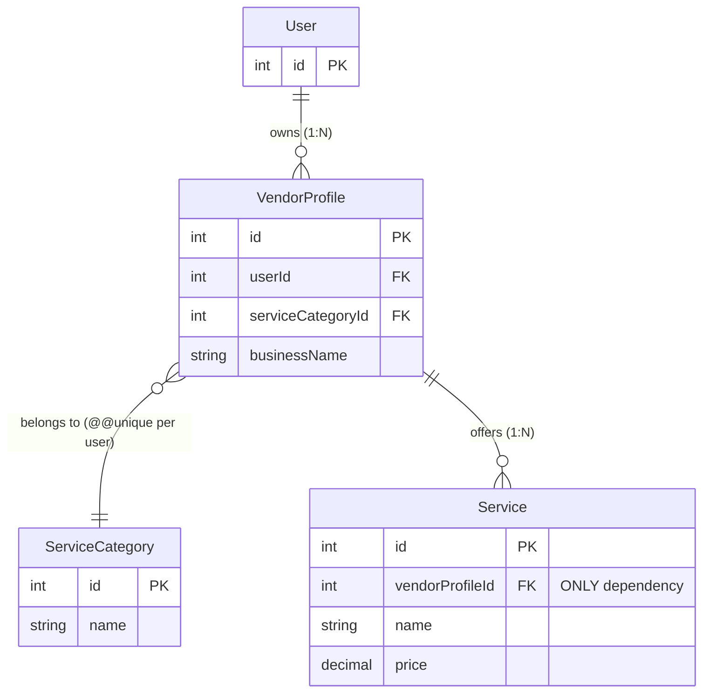
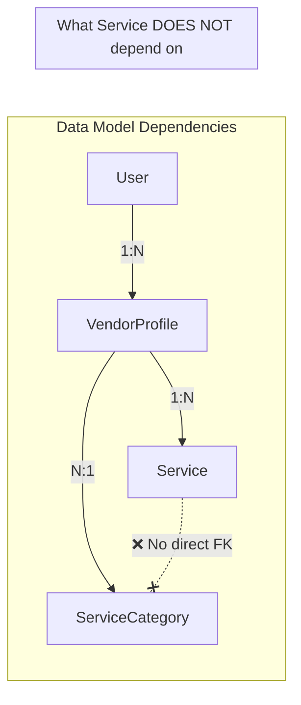

# VendorProfile / Service / ServiceCategory — Relationship Report

> **Date**: 2026-02-18  
> **Scope**: Schema alignment, data integrity enforcement, and dependency cleanup

---

## 1. Executive Summary

This report documents the enforcement of three critical design rules for the VendorProfile module:

| Rule | Status | Enforcement Layer |
|:---|:---:|:---|
| User can own multiple VendorProfiles | ✅ Done | User `1:N` VendorProfile (schema) |
| Only one **active** VendorProfile per ServiceCategory per user | ✅ Done | DB partial unique index + Application-level check |
| Service depends ONLY on VendorProfile (not ServiceCategory) | ✅ Done | Schema FK + Zod schema cleanup |

---

## 2. Changes Made

### 2.1 Prisma Schema (`prisma/schema.prisma`)

#### Why NOT `@@unique([userId, serviceCategoryId])`?

A standard `@@unique` constraint applies to **all rows** in the table, including soft-deleted ones. This means:

> [!WARNING]
> If a user soft-deletes their profile in category "DJ" (`deletedAt = '2026-02-18'`), they can **never** create a new profile in "DJ" — the old row still occupies the unique slot.

#### Solution: Partial Unique Index

PostgreSQL supports `WHERE` clauses on unique indexes. We created a **custom migration** with:

```sql
CREATE UNIQUE INDEX "VendorProfile_userId_serviceCategoryId_active"
ON "VendorProfile" ("userId", "serviceCategoryId")
WHERE "deletedAt" IS NULL;
```

**Effect**:
| Scenario | Standard `@@unique` | Partial Unique Index |
|:---|:---:|:---:|
| Two active profiles in same category | ❌ Blocked | ❌ Blocked |
| Re-create after soft delete | ❌ Blocked | ✅ Allowed |
| Multiple soft-deleted in same category | ❌ Blocked | ✅ Allowed |

**Migration file**: `prisma/migrations/20260218112800_add_vendor_profile_active_unique/migration.sql`

> [!NOTE]
> Since Prisma's `@@unique` doesn't support `WHERE` clauses, this index is managed via raw SQL in a custom migration. The `schema.prisma` file contains a comment explaining this.

**Service Model** — already correct, no `serviceCategoryId` FK:

```prisma
model Service {
  id              Int     @id @default(autoincrement())
  name            String
  description     String? @db.Text
  price           Decimal @db.Decimal(10, 2)
  vendorProfileId Int
  vendorProfile   VendorProfile @relation(fields: [vendorProfileId], references: [id])
}
```

### 2.2 Zod Schema (`src/modules/vendors/vendor.schema.ts`)

**Removed** `serviceCategoryId` from `createServiceSchema`:

```diff
 export const createServiceSchema = z.object({
     name: z.string(...),
     description: z.string(...).optional(),
     price: z.number(...),
-    serviceCategoryId: z.number(...).int().positive(),
 });
```

**Rationale**: Since `Service` has no FK to `ServiceCategory`, requiring this field in the API request body was misleading and unused. Services inherit their category context implicitly through the parent `VendorProfile`.

### 2.3 Service Layer (`src/modules/vendors/vendor.service.ts`)

The `addService()` method was **already correct** — it only writes `vendorProfileId` to the database:

```typescript
const service = await prisma.service.create({
    data: {
        name: data.name,
        description: data.description ?? null,
        price: data.price,
        vendorProfileId: vendorId, // ← Only FK
    },
});
```

No changes were required to the service layer.

---

## 3. Relationship Architecture



### Dependency Flow



---

## 4. Business Rules Enforcement Matrix

| Rule | DB Layer | App Layer | Zod Validation |
|:---|:---:|:---:|:---:|
| One **active** profile per category per user | Partial unique index `WHERE deletedAt IS NULL` | `findFirst()` check → 409 | `serviceCategoryId` required in `createVendorSchema` |
| Service belongs to VendorProfile only | FK `vendorProfileId` only | Ownership check on vendor | No `serviceCategoryId` in `createServiceSchema` |
| Category required for profile | FK `serviceCategoryId` NOT NULL | `prisma.serviceCategory.findUnique()` check | `serviceCategoryId` required in `createVendorSchema` |
| User can have multiple profiles | No unique on `userId` alone | N/A | N/A |

---

## 5. Build Verification

| Check | Result |
|:---|:---:|
| `npx prisma generate` | ✅ Passed |
| `npx tsc --noEmit` | ✅ Passed (zero errors) |
| Schema coherence | ✅ Service has no ServiceCategory FK |
| Unique constraint | ✅ Partial unique index (custom migration) |

---

## 6. Files Modified

| File | Change |
|:---|:---|
| `prisma/schema.prisma` | Replaced `@@unique` with comment referencing custom migration |
| `prisma/migrations/20260218.../migration.sql` | Partial unique index `WHERE deletedAt IS NULL` |
| `src/modules/vendors/vendor.schema.ts` | Removed `serviceCategoryId` from `createServiceSchema` |
| `docs/vendor_profile/implementation_plan.md` | Updated ERD, constraints section, Phase 2c, verification plan |
| `docs/vendor_profile/task.md` | Added Phase 2c tasks, new test item for one-profile-per-category |

---

## 7. Recommendations

1. **Run `npx prisma migrate dev`** to apply the custom migration with the partial unique index.
2. **Check existing data** for duplicate **active** `(userId, serviceCategoryId)` pairs (where `deletedAt IS NULL`) before migrating — the index creation will fail if violations exist.
3. **Phase 3 (Service Management)** can now proceed knowing that `addService` / `removeService` / `getServices` are clean — no `serviceCategoryId` handling needed.
