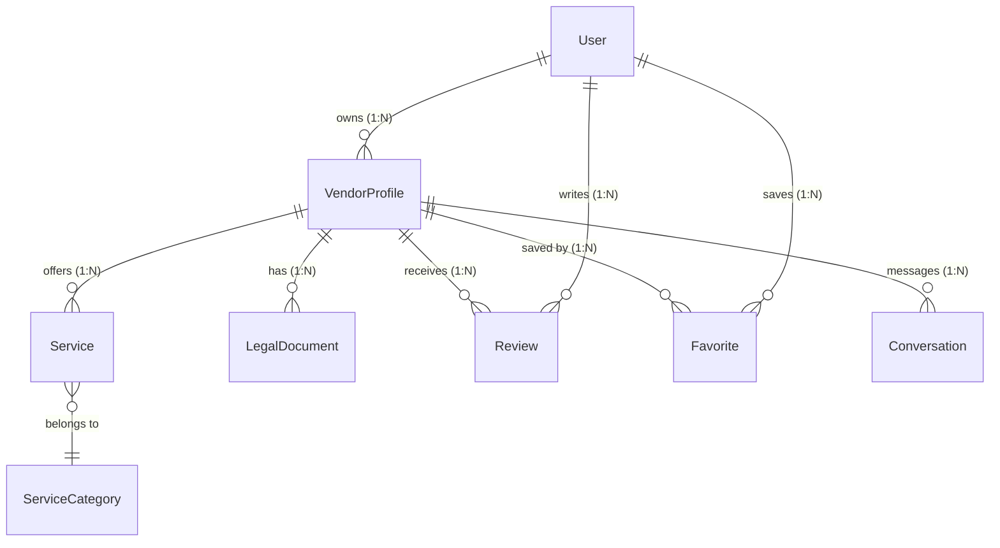
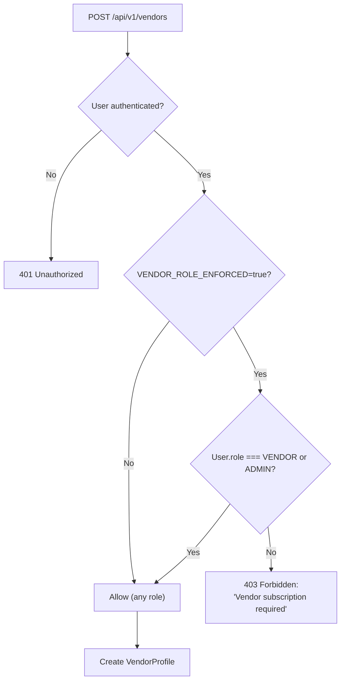
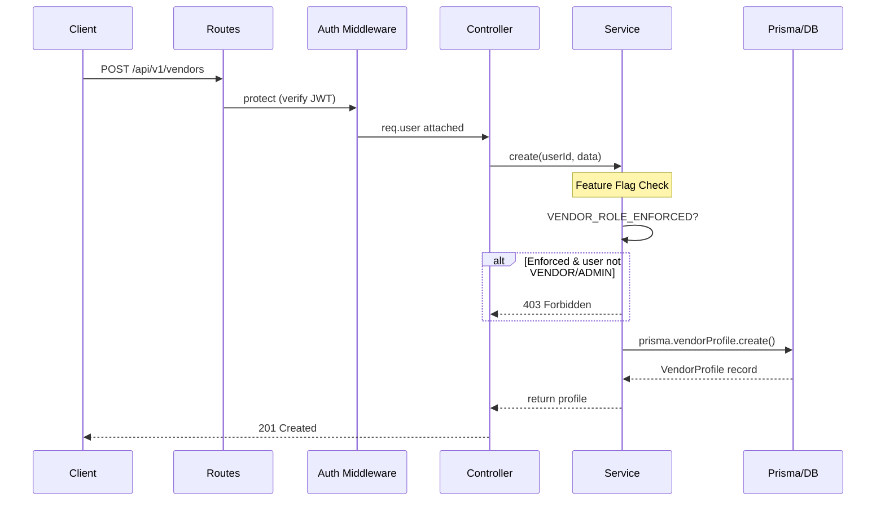

# VendorProfile Module — Implementation Plan

## Overview

Build a fully functional **VendorProfile** module by replacing the existing placeholder scaffold (`501 Not Implemented`) with production-ready business logic. The module enables authenticated users to create and manage vendor profiles (business listings), similar to how Airbnb hosts create listing profiles or how Fiverr sellers set up their gigs.

> [!NOTE]
> The existing scaffold already provides the 4-file structure (`schema`, `service`, `controller`, `routes`), schemas, controller delegation, and route definitions. **This plan focuses on implementing the service layer** and adding the feature-flag mechanism for vendor role enforcement.

---

## Data Model

### VendorProfile & Relationships



### Key Fields

| Field | Type | Notes |
|-------|------|-------|
| `businessName` | `String` | Required, 2-100 chars |
| `bio` | `Text?` | Optional, max 2000 chars |
| `basePrice` | `Decimal(10,2)` | Starting price (for search/filter) |
| `portfolioImages` | `String[]` | Array of CDN image URLs |
| `city` | `String` | Required (for location filtering) |
| `locationCoordinates` | `Json?` | Optional `{ lat, lng }` |
| `userId` | `Int` | FK to User (owner) |

### Relationship Summary

| Relation | Type | Purpose |
|----------|------|---------|
| `User → VendorProfile` | 1:N | One user can own multiple vendor profiles (e.g., different businesses) |
| `VendorProfile → Service` | 1:N | Packages/tiers (e.g., "Budget Photography", "Premium Photography") |
| `VendorProfile → LegalDocument` | 1:N | Compliance docs (future: admin verification flow) |
| `VendorProfile → Review` | 1:N | Customer reviews with ratings |
| `VendorProfile → Favorite` | 1:N | Wishlisted by customers |
| `VendorProfile → Conversation` | 1:N | Customer-vendor messaging |

---

## Feature Flag: Vendor Role Enforcement

### The Problem

Currently, only `VENDOR` role users should create profiles (for future payment gating).
But for the initial launch, **any authenticated user** should be able to create a vendor profile — no payment required.

### The Solution (Airbnb-style)

A single environment variable controls whether the `VENDOR` role check is enforced:

```env
# .env
VENDOR_ROLE_ENFORCED=false   # Launch mode: any authenticated user can create
# VENDOR_ROLE_ENFORCED=true  # Post-payment: only VENDOR role users can create
```

### How It Works



### Implementation Detail

The enforcement lives in the **service layer**, not the route layer. This means:
- `.env` change → instant behavior change, no code deploy needed
- The route middleware stays `protect` (authentication only)
- The service layer checks `process.env.VENDOR_ROLE_ENFORCED` before applying role logic

> [!IMPORTANT]
> When you're ready to integrate payments, set `VENDOR_ROLE_ENFORCED=true` in `.env`. Users who pay get the `VENDOR` role via your payment webhook. **One line change, one place.**

---

## Request Flow



---

## Proposed Changes

### Component 1: Environment Config

#### [MODIFY] [.env](file:///d:/work/advert_app/backend/.env)

Add feature flag:

```env
# Vendor Role Gate (set to "true" to restrict to VENDOR role only)
VENDOR_ROLE_ENFORCED=false
```

#### [MODIFY] [.env.example](file:///d:/work/advert_app/backend/.env.example) *(if exists)*

Document the flag for other developers.

---

### Component 2: Service Layer (Core Logic)

#### [MODIFY] [vendor.service.ts](file:///d:/work/advert_app/backend/src/modules/vendors/vendor.service.ts)

Replace all placeholder `throw new AppError('... not implemented', 501)` with real Prisma logic.

**Methods to implement:**

| Method | Logic |
|--------|-------|
| `findAll(query)` | Paginated list with city, minPrice, maxPrice filters. Include `_count.reviews`, `_count.services`. Sort by `createdAt DESC`. |
| `findById(id)` | Fetch profile with `services`, `_count.reviews`, `_count.favorites`. Throw 404 if missing. |
| `create(userId, data)` | **Feature flag check** → create profile. Return with includes. |
| `update(id, userId, data)` | Verify ownership (owner or ADMIN). Partial update. Throw 404/403. |
| `delete(id, userId, data)` | Verify ownership or ADMIN. Cascade awareness (Prisma handles FKs). Throw 404/403. |
| `getServices(vendorId)` | List services with `serviceCategory` include. Throw 404 if vendor missing. |
| `addService(vendorId, userId, data)` | Verify ownership. Validate `serviceCategoryId` exists. Create service. |
| `removeService(vendorId, serviceId, userId)` | Verify ownership. Delete service. Throw 404. |

**Key patterns** (inspired by service-category.service.ts):

```typescript
// Feature flag check in create()
private checkVendorRoleGate(userRole: string): void {
    const enforced = process.env.VENDOR_ROLE_ENFORCED === 'true';
    if (enforced && userRole !== 'VENDOR' && userRole !== 'ADMIN') {
        throw new AppError(
            'Vendor subscription required. Please upgrade to create a vendor profile.',
            403
        );
    }
}
```

**Ownership check pattern:**

```typescript
private async verifyOwnership(profileId: number, userId: number, userRole: string) {
    const profile = await prisma.vendorProfile.findUnique({ where: { id: profileId } });
    if (!profile) throw new AppError('Vendor profile not found', 404);
    if (profile.userId !== userId && userRole !== 'ADMIN') {
        throw new AppError('You are not authorized to modify this profile', 403);
    }
    return profile;
}
```

---

### Component 3: Route Adjustments

#### [MODIFY] [vendor.routes.ts](file:///d:/work/advert_app/backend/src/modules/vendors/vendor.routes.ts)

Minor changes — the route structure is already correct, but the `restrictTo('VENDOR', 'ADMIN')` on `POST /` should be **removed** since the feature flag handles this in the service layer. This allows any authenticated user to reach the endpoint, and the service decides based on the flag.

```diff
  router.post(
      '/',
      protect,
-     restrictTo('VENDOR', 'ADMIN'),
      validateRequest(createVendorSchema),
      vendorController.createVendor
  );
```

> [!NOTE]
> `restrictTo` is removed from the route because the role-gating logic is now in the service layer, controlled by the `VENDOR_ROLE_ENFORCED` env variable. When the flag is `false`, any authenticated user can create. When `true`, the service enforces `VENDOR`/`ADMIN` only.

---

### Component 4: Controller Adjustments

#### [MODIFY] [vendor.controller.ts](file:///d:/work/advert_app/backend/src/modules/vendors/vendor.controller.ts)

Minor change — pass `req.user.role` to service methods that need the feature flag or ownership check.

```diff
  export const createVendor = async (req: Request, res: Response) => {
-     const userId = req.user!.id;
+     const { id: userId, role: userRole } = req.user!;
      const data = req.body as CreateVendorInput;
-     const vendor = await vendorService.create(userId, data);
+     const vendor = await vendorService.create(userId, userRole, data);
      sendCreated(res, { vendor }, 'Vendor profile created successfully');
  };
```

Same pattern for `update`, `delete`, `addService`, `removeService` — pass `userRole`.

---

### Component 5: Schema Validation (Minor)

#### [MODIFY] [vendor.schema.ts](file:///d:/work/advert_app/backend/src/modules/vendors/vendor.schema.ts)

The existing schemas are already well-defined. Minor refinements if needed:
- Add `search` query param to `listVendorsQuerySchema`
- Add `sortBy` and `sortOrder` params for flexibility

---

### Component 6: E2E Test Suite

#### [NEW] [vendor.test.ts](file:///d:/work/advert_app/backend/src/modules/vendors/__tests__/vendor.test.ts)

Following the patterns from `service-category.test.ts` and `event-type.test.ts`:

| Test Group | Tests |
|------------|-------|
| **Public Access** | GET `/` returns 200 without auth; GET `/:id` returns 200 |
| **Auth Guard** | POST `/` returns 401 without token; PATCH/DELETE return 401 |
| **Feature Flag (off)** | CUSTOMER can create profile when `VENDOR_ROLE_ENFORCED=false` |
| **Feature Flag (on)** | CUSTOMER gets 403 when `VENDOR_ROLE_ENFORCED=true` |
| **POST /  (create)** | Successful create; validate required fields; duplicate handling |
| **GET / (list)** | Pagination; city filter; price range filter; search |
| **GET /:id (detail)** | Includes services + counts; 404 for non-existent |
| **PATCH /:id (update)** | Owner can update; non-owner gets 403; ADMIN can update; 404 |
| **DELETE /:id (delete)** | Owner can delete; non-owner gets 403; ADMIN can delete; 204 |
| **Services (nested)** | Add service; get services; remove service; ownership checks |

---

## File Change Summary

| File | Action | Scope |
|------|--------|-------|
| `.env` | MODIFY | Add `VENDOR_ROLE_ENFORCED=false` |
| `vendor.service.ts` | MODIFY | Replace placeholders with Prisma logic (main work) |
| `vendor.routes.ts` | MODIFY | Remove `restrictTo('VENDOR', 'ADMIN')` from POST |
| `vendor.controller.ts` | MODIFY | Pass `userRole` to service methods |
| `vendor.schema.ts` | MODIFY | Minor: add `search`/`sortBy` query params |
| `vendor.test.ts` | NEW | E2E test suite (~30+ tests) |

---

## Verification Plan

### Automated Tests

```bash
npx cross-env NODE_ENV=test npx jest --detectOpenHandles --testPathPatterns="vendor" --verbose
```

### Build Check

```bash
npx tsc --noEmit
```

### Manual Verification

```bash
# 1. Public listing (no token)
curl http://localhost:8000/api/v1/vendors

# 2. Create as any user (flag OFF)
curl -X POST http://localhost:8000/api/v1/vendors \
  -H "Authorization: Bearer <token>" \
  -H "x-csrf-token: <csrf>" \
  -H "Content-Type: application/json" \
  -d '{"businessName":"My Photography","basePrice":500,"city":"Addis Ababa"}'

# 3. Create as CUSTOMER (flag ON) → should get 403
VENDOR_ROLE_ENFORCED=true npm run dev
curl -X POST http://localhost:8000/api/v1/vendors ...
```
