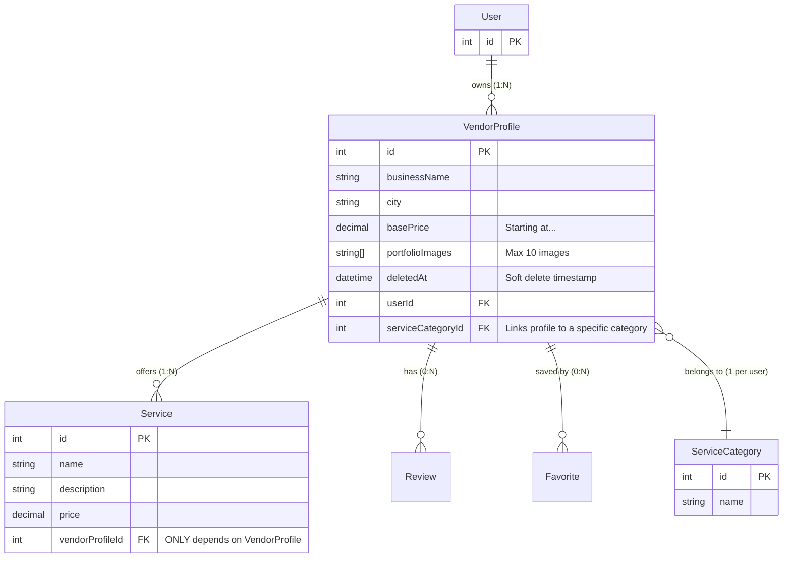
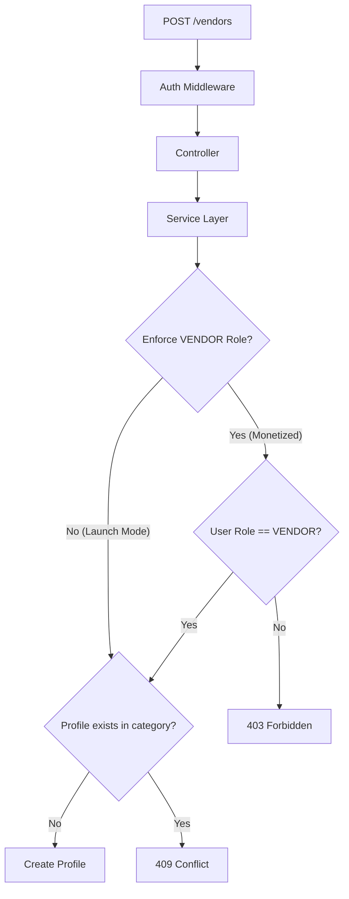

# VendorProfile Module — Implementation Plan

> [!NOTE]
> This plan outlines the roadmap to move the `VendorProfile` module from a placeholder scaffold to a fully functional, production-ready feature.

## 1. Overview

The **VendorProfile** module is the core of the multi-vendor system, allowing users to create business profiles, list services, and manage their public presence. This implementation follows the **Clean Architecture** pattern used in `event-types` and `service-categories`.

### Goals
- **Enable Vendor Onboarding**: Users can create business profiles.
- **Service Management**: Vendors can list multiple services (packages) under their profile.
- **Role Enforcement (Feature Flag)**: Control who can create profiles (anyone vs. VENDOR role) via `.env`.
- **Search & Discovery**: Public API to search vendors by city, price, and category.
- **Data Preservation (Soft Delete)**: Deleting a profile preserves reviews, favorites, and conversations.
- **Granular Image Management**: Add/remove portfolio images individually with a max limit.

### Key Design Constraints

> [!IMPORTANT]
> **One Profile Per Category Per User**: A user can own multiple `VendorProfile` records, but only **one active profile per `ServiceCategory`**. This is enforced at both:
> - **Application level**: Service layer `findFirst()` check with `deletedAt: null` filter.
> - **Database level**: A PostgreSQL **partial unique index** on `(userId, serviceCategoryId) WHERE deletedAt IS NULL`. This was chosen over `@@unique` because a standard unique constraint blocks re-creation after soft delete (it counts ALL rows, including soft-deleted ones).

> [!IMPORTANT]
> **Service Depends ONLY on VendorProfile**: The `Service` model has no direct relationship to `ServiceCategory`. A service inherits its category implicitly through the parent `VendorProfile.serviceCategoryId`. This means:
> - A vendor **cannot** offer services across multiple categories from one profile.
> - The `createServiceSchema` has no `serviceCategoryId` field.
> - Services are always scoped to the vendor profile they belong to.

---

## 2. System Architecture & Data Model

### Entity Relationship Diagram (ERD)



> [!NOTE]
> **Unique Constraint (Partial Index)**: Instead of `@@unique([userId, serviceCategoryId])`, we use a PostgreSQL **partial unique index** that only applies `WHERE "deletedAt" IS NULL`. This allows:
> - ✅ One active profile per category per user
> - ✅ Re-creating a profile in a category after soft-deleting the old one
> - ✅ Multiple soft-deleted profiles in the same category
>
> See: `prisma/migrations/20260218112800_add_vendor_profile_active_unique/migration.sql`

### Feature Flag Logic (Role Enforcement)

To support a frictionless launch (allowing anyone to become a vendor) while preparing for future monetization (requiring paid subscription/VENDOR role), we will use a Feature Flag in the **Service Layer**.



---

## 3. Implementation Roadmap

### Phase 1: Configuration & Setup
- [x] **Environment Variables**: Add `VENDOR_ROLE_ENFORCED` to `.env`.
- [x] **Validation Schemas**: Refine Zod schemas in `vendor.schema.ts` for search and sort operations.

### Phase 2: Core Service Logic (`vendor.service.ts`)
- [x] **`create`**: Implement profile creation with the feature flag check.
- [x] **`findAll`**: Implement pagination, filtering (city, price), and sorting.
- [x] **`findById`**: Fetch profile with relations (`services`, `reviews` count).
- [x] **`update`**: Implement partial updates with strict ownership checks.
- [x] **`delete`**: Implement soft deletion (sets `deletedAt`) with ownership checks.

### Phase 2b: Soft Delete & Image Management
- [x] **Soft Delete**: Add `deletedAt` field to `VendorProfile` Prisma schema.
- [x] **Active Filter**: Exclude soft-deleted profiles from all public queries (`findAll`, `findById`).
- [x] **Image Schema**: Add `updatePortfolioImagesSchema` (add/remove operations) and `MAX_PORTFOLIO_IMAGES` constant.
- [x] **`updatePortfolioImages`**: Granular add/remove with deduplication and max limit enforcement.
- [x] **Route**: `PATCH /vendors/:id/images` endpoint for image management.
- [x] **Remove `portfolioImages` from `updateVendorSchema`**: Images managed only via dedicated endpoint.

### Phase 2c: Data Integrity & Schema Alignment
- [x] **DB Partial Unique Index**: Custom migration with `CREATE UNIQUE INDEX ... WHERE "deletedAt" IS NULL` — replaces `@@unique` to support soft-delete re-creation.
- [x] **Decouple Service from ServiceCategory**: Removed `serviceCategoryId` from `createServiceSchema` — services inherit category from VendorProfile.
- [x] **Service Model**: Confirmed `Service` model has no direct FK to `ServiceCategory` in Prisma schema.

### Phase 3: Service Management (Nested Resources)
- [ ] **`addService`**: Logic to add a service package to a vendor profile.
- [ ] **`removeService`**: Logic to remove a service package.
- [ ] **`getServices`**: Fetch all services for a specific vendor.

### Phase 4: Controller & Routes
- [ ] **Controller**: Connect `req.user` and `req.body` to service methods.
- [ ] **Routes**: Define endpoints and apply `protect` middleware. **Remove** `restrictTo` from `POST /` to let the service handle logic.

### Phase 5: Testing & Verification
- [ ] **E2E Tests**: Create `vendor.test.ts` covering all scenarios.
- [ ] **Manual Verification**: Test via HTTP client (Postman/Curl).

---

## 4. Detailed Component Design

### A. API Routes & Controller Map

| Method | Endpoint | Access | Controller | Service Method | Description |
|:---|:---|:---|:---|:---|:---|
| **GET** | `/api/v1/vendors` | Public | `getAllVendors` | `findAll(query)` | List vendors with filters (city, price) |
| **GET** | `/api/v1/vendors/:id` | Public | `getVendorById` | `findById(id)` | Get detailed profile + services |
| **POST** | `/api/v1/vendors` | Auth | `createVendor` | `create(userId, role, data)` | Create new profile (Role gated via env) |
| **PATCH** | `/api/v1/vendors/:id` | Owner | `updateVendor` | `update(id, userId, data)` | Update profile details |
| **DELETE**| `/api/v1/vendors/:id` | Owner/Admin | `deleteVendor` | `delete(id, userId)` | Soft-delete profile (sets `deletedAt`) |
| **PATCH** | `/api/v1/vendors/:id/images` | Owner | `updatePortfolioImages` | `updatePortfolioImages(id, userId, data)` | Add/remove portfolio images |
| **GET** | `/vendors/:id/services` | Public | `getVendorServices` | `getServices(id)` | List a vendor's services |
| **POST** | `/vendors/:id/services` | Owner | `addService` | `addService(id, userId, data)` | Add a new service package |
| **DELETE**| `/vendors/:id/services/:sid`| Owner | `removeService` | `removeService(id, sid, userId)` | Remove a service package |

### B. Service Logic Specification

#### 1. `create(userId: number, userRole: string, data: CreateVendorInput)`
- **Feature Flag Check**:
  - Read `process.env.VENDOR_ROLE_ENFORCED`.
  - IF `true` AND `userRole` is NOT `VENDOR` or `ADMIN` -> Throw `403 Forbidden ("Subscription required")`.
- **Business Logic**:
  - One user can create **multiple** vendor profiles, but **only one active profile per ServiceCategory**.
  - **DB Constraint**: Partial unique index on `(userId, serviceCategoryId) WHERE deletedAt IS NULL` — prevents duplicates among active rows only.
  - **App-level Check**: `findFirst({ userId, serviceCategoryId, deletedAt: null })` provides a user-friendly `409 Conflict` before hitting the DB constraint.
  - `prisma.vendorProfile.create({ data: { ...data, userId, serviceCategoryId } })`.
- **Return**: Created profile with standard fields and category details.

#### 2. `findAll(query: ListVendorsQuery)`
- **Filters**:
  - `city`: case-insensitive contains or exact match.
  - `minPrice` / `maxPrice`: Filter by `basePrice`.
  - `search`: Search in `businessName` or `bio`.
- **Pagination**: Standard `skip`/`take`.
- **Sorting**: Default `createdAt` (desc), allow `basePrice` (asc/desc).
- **Includes**: `_count: { reviews: true, services: true }`.

#### 3. `update(id: number, userId: number, data: UpdateVendorInput)`
- **Ownership Check**:
  - Find profile by `id`. If not found -> `404`.
  - IF `profile.userId !== userId` AND `userRole !== 'ADMIN'` -> `403 Forbidden`.
- **Update**: `prisma.vendorProfile.update(...)`.

#### 4. `addService(vendorId: number, userId: number, data: CreateServiceInput)`
- **Validation**:
  - Verify `vendorProfile` exists and belongs to `userId`.
  - Service implicitly belongs to the vendor's `serviceCategory` (no `serviceCategoryId` in input).
- **Create**: `prisma.service.create({ data: { name, description, price, vendorProfileId } })`.

---

## 5. Verification Plan

### Automated Tests (`vendor.test.ts`)
We will create a comprehensive test suite using `supertest`.

**Test Scenarios:**
1.  **Public Access**:
    - `GET /vendors` should return 200 and a list.
    - `GET /vendors/:id` should return 200 for existing ID.
2.  **Access Control**:
    - `POST /vendors` without token -> `401`.
    - `PATCH /vendors/:id` as wrong user -> `403`.
3.  **Feature Flag**:
    - Set `VENDOR_ROLE_ENFORCED=true`, try creating as `CUSTOMER` -> `403`.
    - Set `VENDOR_ROLE_ENFORCED=false`, try creating as `CUSTOMER` -> `201`.
4.  **One Profile Per Category**:
    - Create a vendor in category A -> `201`.
    - Create another vendor in category A (same user) -> `409 Conflict`.
    - Create a vendor in category B (same user) -> `201`.
5.  **Data Integrity**:
    - Build a profile, add a service, check if it appears in `GET /vendors/:id`.
    - Services should NOT have a `serviceCategoryId` field.
6.  **Soft Delete**:
    - Delete a vendor profile → expect `204`.
    - `GET /vendors/:id` for deleted profile → expect `404`.
    - `GET /vendors` should NOT include deleted profiles.
    - Re-creating a profile after soft delete → expect `201` (slot freed).
7.  **Portfolio Image Management**:
    - `PATCH /vendors/:id/images` with `{ add: ["url1"] }` → expect image added.
    - `PATCH /vendors/:id/images` with `{ remove: ["url1"] }` → expect image removed.
    - Add images beyond `MAX_PORTFOLIO_IMAGES` (10) → expect `400`.
    - Add + remove in single request → expect remove-first, then add.
    - Duplicate images are deduplicated automatically.

### Manual Verification Steps

1.  **Setup**:
    - Ensure `.env` has `VENDOR_ROLE_ENFORCED=false`.
    - Run server: `npm run dev`.

2.  **Create Vendor (Happy Path)**:
    ```bash
    curl -X POST http://localhost:8000/api/v1/vendors \
      -H "Authorization: Bearer <YOUR_TOKEN>" \
      -H "Content-Type: application/json" \
      -d '{"businessName":"Test Vendor", "city":"New York", "basePrice":100, "serviceCategoryId": 1}'
    ```
    - **Expect**: `201 Created`

3.  **Add Service (No serviceCategoryId needed)**:
    ```bash
    curl -X POST http://localhost:8000/api/v1/vendors/<VENDOR_ID>/services \
      -H "Authorization: Bearer <YOUR_TOKEN>" \
      -H "Content-Type: application/json" \
      -d '{"name":"Basic Package", "price":100}'
    ```
    - **Expect**: `201 Created`

4.  **Search**:
    - Go to `http://localhost:8000/api/v1/vendors?city=New York`
    - **Expect**: List containing the new vendor.
