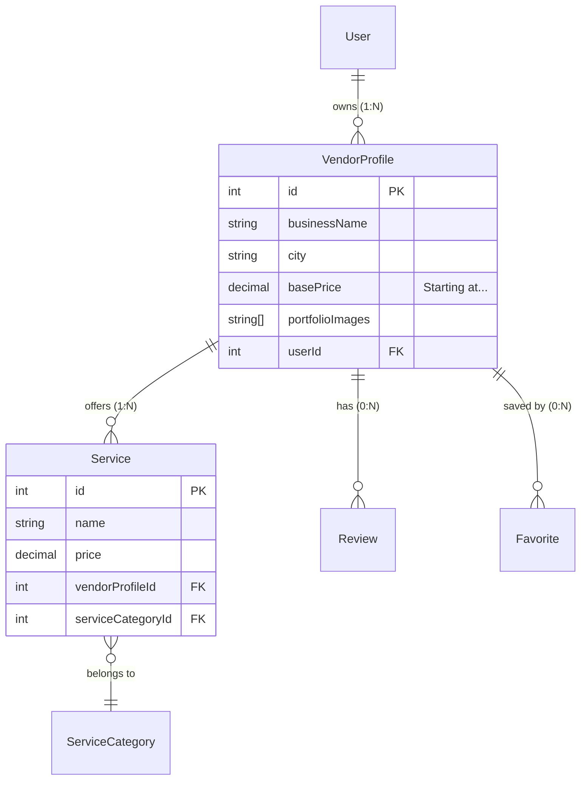
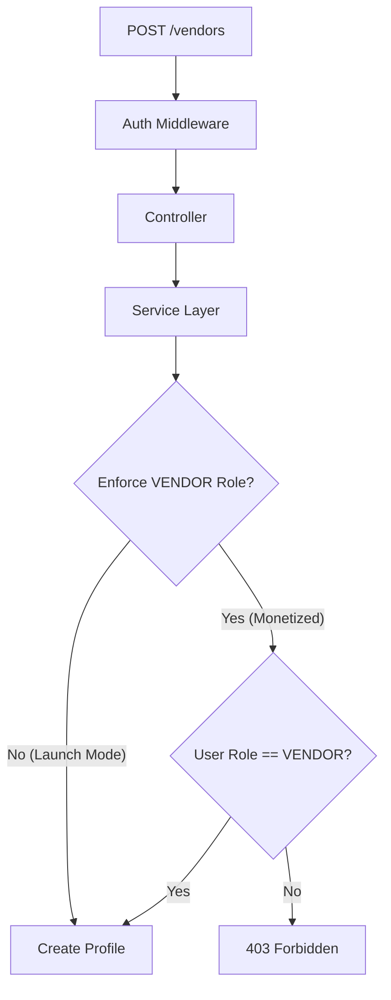

# VendorProfile Module — Implementation Plan

> [!NOTE]
> This plan outlines the roadmap to move the `VendorProfile` module from a placeholder scaffold to a fully functional, production-ready feature.

## 1. Overview

The **VendorProfile** module is the core of the multi-vendor system, allowing users to create business profiles, list services, and manage their public presence. This implementation follows the **Clean Architecture** pattern used in `event-types` and `service-categories`.

### Goals
- **Enable Vendor Onboarding**: Users can create business profiles.
- **Service Management**: Vendors can list multiple services (packages) under their profile.
- **Role Enforcement (Feature Flag)**: Control who can create profiles (anyone vs. VENDOR role) via `.env`.
- **Search & Discovery**: Public API to search vendors by city, price, and category.

---

## 2. System Architecture & Data Model

### Entity Relationship Diagram (ERD)



### Feature Flag Logic (Role Enforcement)

To support a frictionless launch (allowing anyone to become a vendor) while preparing for future monetization (requiring paid subscription/VENDOR role), we will use a Feature Flag in the **Service Layer**.



---

## 3. Implementation Roadmap

### Phase 1: Configuration & Setup
- [ ] **Environment Variables**: Add `VENDOR_ROLE_ENFORCED` to `.env`.
- [ ] **Validation Schemas**: Refine Zod schemas in `vendor.schema.ts` for search and sort operations.

### Phase 2: Core Service Logic (`vendor.service.ts`)
- [ ] **`create`**: Implement profile creation with the feature flag check.
- [ ] **`findAll`**: Implement pagination, filtering (city, price), and sorting.
- [ ] **`findById`**: Fetch profile with relations (`services`, `reviews` count).
- [ ] **`update`**: Implement partial updates with strict ownership checks.
- [ ] **`delete`**: Implement deletion with ownership checks.

### Phase 3: Service Management (Nested Resources)
- [ ] **`addService`**: Logic to add a service package to a vendor profile.
- [ ] **`removeService`**: Logic to remove a service package.
- [ ] **`getServices`**: Fetch all services for a specific vendor.

### Phase 4: Controller & Routes
- [ ] **Controller**: Connect `req.user` and `req.body` to service methods.
- [ ] **Routes**: Define endpoints and apply `protect` middleware. **Remove** `restrictTo` from `POST /` to let the service handle logic.

### Phase 5: Testing & Verification
- [ ] **E2E Tests**: Create `vendor.test.ts` covering all scenarios.
- [ ] **Manual Verification**: Test via HTTP client (Postman/Curl).

---

## 4. Detailed Component Design

### A. API Routes & Controller Map

| Method | Endpoint | Access | Controller | Service Method | Description |
|:---|:---|:---|:---|:---|:---|
| **GET** | `/api/v1/vendors` | Public | `getAllVendors` | `findAll(query)` | List vendors with filters (city, price) |
| **GET** | `/api/v1/vendors/:id` | Public | `getVendorById` | `findById(id)` | Get detailed profile + services |
| **POST** | `/api/v1/vendors` | Auth | `createVendor` | `create(userId, role, data)` | Create new profile (Role gated via env) |
| **PATCH** | `/api/v1/vendors/:id` | Owner | `updateVendor` | `update(id, userId, data)` | Update profile details |
| **DELETE**| `/api/v1/vendors/:id` | Owner/Admin | `deleteVendor` | `delete(id, userId)` | Delete profile |
| **GET** | `/vendors/:id/services` | Public | `getVendorServices` | `getServices(id)` | List a vendor's services |
| **POST** | `/vendors/:id/services` | Owner | `addService` | `addService(id, userId, data)` | Add a new service package |
| **DELETE**| `/vendors/:id/services/:sid`| Owner | `removeService` | `removeService(id, sid, userId)` | Remove a service package |

### B. Service Logic Specification

#### 1. `create(userId: number, userRole: string, data: CreateVendorInput)`
- **Feature Flag Check**:
  - Read `process.env.VENDOR_ROLE_ENFORCED`.
  - IF `true` AND `userRole` is NOT `VENDOR` or `ADMIN` -> Throw `403 Forbidden ("Subscription required")`.
- **Business Logic**:
  - Check if User already has a profile (optional: enforce 1 profile per user if needed, or allow multiple).
  - `prisma.vendorProfile.create({ data: { ...data, userId } })`.
- **Return**: Created profile with standard fields.

#### 2. `findAll(query: ListVendorsQuery)`
- **Filters**:
  - `city`: case-insensitive contains or exact match.
  - `minPrice` / `maxPrice`: Filter by `basePrice`.
  - `search`: Search in `businessName` or `bio`.
- **Pagination**: Standard `skip`/`take`.
- **Sorting**: Default `createdAt` (desc), allow `basePrice` (asc/desc).
- **Includes**: `_count: { reviews: true, services: true }`.

#### 3. `update(id: number, userId: number, data: UpdateVendorInput)`
- **Ownership Check**:
  - Find profile by `id`. If not found -> `404`.
  - IF `profile.userId !== userId` AND `userRole !== 'ADMIN'` -> `403 Forbidden`.
- **Update**: `prisma.vendorProfile.update(...)`.

#### 4. `addService(vendorId: number, userId: number, data: CreateServiceInput)`
- **Validation**:
  - Verify `vendorProfile` exists and belongs to `userId`.
  - Verify `serviceCategoryId` exists in DB.
- **Create**: `prisma.service.create(...)`.

---

## 5. Verification Plan

### Automated Tests (`vendor.test.ts`)
We will create a comprehensive test suite using `supertest`.

**Test Scenarios:**
1.  **Public Access**:
    - `GET /vendors` should return 200 and a list.
    - `GET /vendors/:id` should return 200 for existing ID.
2.  **Access Control**:
    - `POST /vendors` without token -> `401`.
    - `PATCH /vendors/:id` as wrong user -> `403`.
3.  **Feature Flag**:
    - Set `VENDOR_ROLE_ENFORCED=true`, try creating as `CUSTOMER` -> `403`.
    - Set `VENDOR_ROLE_ENFORCED=false`, try creating as `CUSTOMER` -> `201`.
4.  **Data Integrity**:
    - Build a profile, add a service, check if it appears in `GET /vendors/:id`.

### Manual Verification Steps

1.  **Setup**:
    - Ensure `.env` has `VENDOR_ROLE_ENFORCED=false`.
    - Run server: `npm run dev`.

2.  **Create Vendor (Happy Path)**:
    ```bash
    curl -X POST http://localhost:8000/api/v1/vendors \
      -H "Authorization: Bearer <YOUR_TOKEN>" \
      -H "Content-Type: application/json" \
      -d '{"businessName":"Test Vendor", "city":"New York", "basePrice":100}'
    ```
    - **Expect**: `201 Created`

3.  **Add Service**:
    ```bash
    curl -X POST http://localhost:8000/api/v1/vendors/<VENDOR_ID>/services \
      -H "Authorization: Bearer <YOUR_TOKEN>" \
      -H "Content-Type: application/json" \
      -d '{"name":"Gold Package", "price":500, "serviceCategoryId":1}'
    ```
    - **Expect**: `201 Created`

4.  **Search**:
    - Go to `http://localhost:8000/api/v1/vendors?city=New York`
    - **Expect**: List containing the new vendor.
