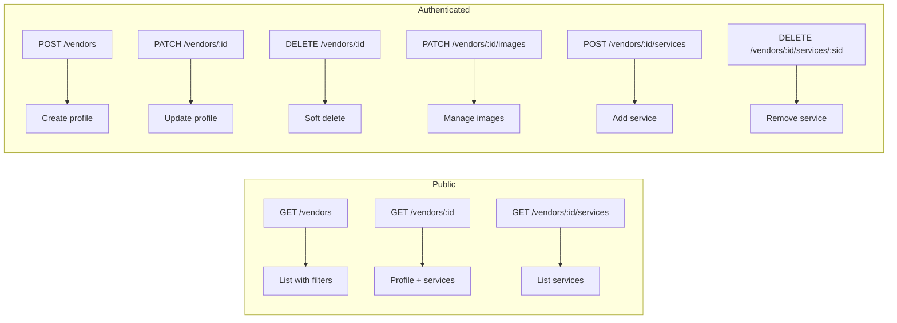
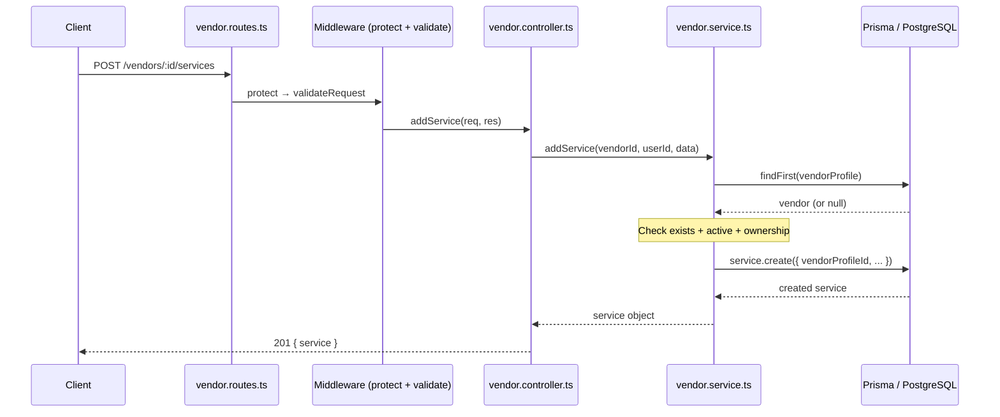

# Phase 3 & 4 Implementation Report

> **Module**: VendorProfile — Nested Service Management & Controller/Routes  
> **Date**: 2026-02-20  
> **Status**: ✅ Complete — Build verified (`npx tsc --noEmit` passes)

---

## 1. Summary

Phase 3 and Phase 4 implement the **nested service management** layer and wire it to the **HTTP layer** (controller + routes). After this, vendors can create, list, and remove service packages under their profile through the REST API.

---

## 2. Phase 3: Nested Service Management

### 2.1 `addService(vendorId, userId, data)`

**File**: `src/modules/vendors/vendor.service.ts` (lines 362–390)

**Logic**:
1. Verify the `VendorProfile` exists and is **active** (`deletedAt: null`).
2. Verify the requesting user **owns** the profile (`vendor.userId === userId`).
3. Create a `Service` record linked only to `vendorProfileId` — **no** `serviceCategoryId` required (services inherit category from the parent profile).
4. Return the created service.

**Key Design Decision**: Service has no direct FK to `ServiceCategory`. This keeps the data model clean — a vendor's services are always in the same category as the profile.

### 2.2 `removeService(vendorId, serviceId, userId)`

**File**: `src/modules/vendors/vendor.service.ts` (lines 397–424)

**Logic**:
1. Verify the `VendorProfile` exists and is active.
2. Verify ownership.
3. Find the `Service` by ID and confirm it belongs to this vendor (`service.vendorProfileId === vendorId`).
4. **Hard delete** the service (`prisma.service.delete`).

> [!NOTE]
> Services are hard-deleted (not soft-deleted), since they are transient data owned by the vendor. If the vendor deletes their profile (soft delete), the services remain in the DB as orphaned records linked to the soft-deleted profile.

### 2.3 `getServices(vendorId)`

**File**: `src/modules/vendors/vendor.service.ts` (lines 429–448)

**Logic**:
1. Verify the `VendorProfile` exists and is active.
2. Fetch all `Service` records where `vendorProfileId === vendorId`.
3. Return the list.

---

## 3. Phase 4: Controller & Routes

### 3.1 Controller Handlers

**File**: `src/modules/vendors/vendor.controller.ts`

| Handler | Line | Description |
|:---|:---|:---|
| `getVendorServices` | 150–158 | Extracts `:id` param, calls `vendorService.getServices(id)` |
| `addService` | 165–177 | Extracts `req.user.id`, `:id` param, and body; calls `vendorService.addService()` |
| `removeService` | 184–195 | Extracts `req.user.id`, `:id`, `:serviceId`; calls `vendorService.removeService()` |

**`userRole` forwarding**: The `createVendor` and `updateVendor` controllers already pass `req.user!.role` to the service layer for feature-flag and ownership checks. The service management controllers don't need role — they use ownership checks only.

### 3.2 Route Definitions

**File**: `src/modules/vendors/vendor.routes.ts`

| Method | Endpoint | Middleware | Controller |
|:---|:---|:---|:---|
| `GET` | `/:id/services` | validate `idParam` | `getVendorServices` |
| `POST` | `/:id/services` | `protect`, validate `idParam` + `createServiceSchema` | `addService` |
| `DELETE` | `/:id/services/:serviceId` | `protect`, validate `serviceIdParamSchema` | `removeService` |

> [!IMPORTANT]
> **`restrictTo` removed from POST `/`**: The `POST /api/v1/vendors` route uses only `protect` (authentication). Role enforcement is handled in the **service layer** via the `VENDOR_ROLE_ENFORCED` feature flag. This allows the same codebase to run in "open" mode (anyone can create a profile) or "monetized" mode (only VENDOR/ADMIN roles).

### 3.3 Validation Schemas

**File**: `src/modules/vendors/vendor.schema.ts`

| Schema | Purpose |
|:---|:---|
| `createServiceSchema` | Validates `name` (2–100 chars), `description` (optional, max 1000 chars), `price` (positive number) |
| `serviceIdParamSchema` | Validates both `:id` and `:serviceId` as numeric params |

---

## 4. API Endpoints (Full)



### Service Management cURL Examples

**Add a service:**
```bash
curl -X POST http://localhost:8000/api/v1/vendors/1/services \
  -H "Authorization: Bearer <TOKEN>" \
  -H "Content-Type: application/json" \
  -d '{"name":"Basic DJ Package", "description":"4 hours of music", "price":500}'
```
→ Expected: `201 Created`

**List vendor services:**
```bash
curl http://localhost:8000/api/v1/vendors/1/services
```
→ Expected: `200 OK` with `{ services: [...] }`

**Remove a service:**
```bash
curl -X DELETE http://localhost:8000/api/v1/vendors/1/services/3 \
  -H "Authorization: Bearer <TOKEN>"
```
→ Expected: `204 No Content`

---

## 5. Data Flow Diagram



---

## 6. Build Verification

```
> npx tsc --noEmit
(no errors — clean build ✅)
```

---

## 7. Remaining Work

| Phase | Status |
|:---|:---|
| Phase 1: Configuration & Setup | ✅ Complete |
| Phase 2: Core Service Logic | ✅ Complete |
| Phase 2b: Soft Delete & Image Management | ✅ Complete |
| Phase 2c: Data Integrity & Schema Alignment | ✅ Complete |
| **Phase 3: Nested Service Management** | **✅ Complete** |
| **Phase 4: Controller & Routes** | **✅ Complete** |
| Phase 5: Verification & Testing | ⬜ Pending |
