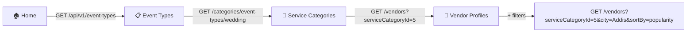

# Vendor Profiles by ServiceCategory — Implementation Plan

## Background

After a user picks a service category (e.g. "DJ" from the Wedding event type), they need to see all vendor profiles in that category. The existing `GET /api/v1/vendors` endpoint already has rich search, filter, sort, and pagination — but **it has no `serviceCategoryId` filter**.

### How Airbnb Handles This

Airbnb doesn't create a separate endpoint per category. Instead, they use a **single listing endpoint with a category filter**:

```
GET /api/v3/explore_tabs?category_tag=DJ
```

Everything else (price range, location, search, sorting) uses the same endpoint with additional query parameters. This is the industry standard pattern — one flexible listing endpoint that accepts multiple filter dimensions.

**Our approach follows the same pattern**: add `serviceCategoryId` as a filter to the existing `GET /api/v1/vendors` endpoint.

### Current State vs What's Needed

| Feature | Current | After |
|---|---|---|
| Filter by city | ✅ `?city=Addis` | ✅ Same |
| Filter by price range | ✅ `?minPrice=100&maxPrice=500` | ✅ Same |
| Search (businessName, bio) | ✅ `?search=DJ` | ✅ Same |
| Sort by price/rating/popularity | ✅ `?sortBy=popularity` | ✅ Same |
| Pagination | ✅ `?page=1&limit=10` | ✅ Same |
| **Filter by service category** | ❌ Missing | ✅ `?serviceCategoryId=5` |

## Proposed Changes

### Vendors Module

#### [MODIFY] [vendor.schema.ts](file:///d:/work/advert_app/backend/src/modules/vendors/vendor.schema.ts)

Add `serviceCategoryId` to `listVendorsQuerySchema`:

```diff
 export const listVendorsQuerySchema = z.object({
     page: z.string().regex(/^\d+$/).transform(...).optional().default('1'),
     limit: z.string().regex(/^\d+$/).transform(...).optional().default('10'),
     city: z.string().optional(),
     minPrice: z.string().regex(...).transform(...).optional(),
     maxPrice: z.string().regex(...).transform(...).optional(),
     search: z.string().optional(),
+    serviceCategoryId: z
+        .string()
+        .regex(/^\d+$/, 'serviceCategoryId must be a valid number')
+        .transform((val) => parseInt(val, 10))
+        .optional(),
     sortBy: z.enum([...]).optional().default('createdAt'),
     sortOrder: z.enum(['asc', 'desc']).optional().default('desc'),
 });
```

#### [MODIFY] [vendor.service.ts](file:///d:/work/advert_app/backend/src/modules/vendors/vendor.service.ts)

Add `serviceCategoryId` filter in `findAll()`:

```diff
 async findAll(query: ListVendorsQuery) {
-    const { page, limit, city, minPrice, maxPrice, search, sortBy, sortOrder } = query;
+    const { page, limit, city, minPrice, maxPrice, search, serviceCategoryId, sortBy, sortOrder } = query;
     // ...
+    if (serviceCategoryId) {
+        where.serviceCategoryId = serviceCategoryId;
+    }
     // ... rest of existing logic stays exactly the same
 }
```

No changes needed to routes or controller — the query parameter flows through automatically.

## UI Browsing Flow (Complete)



## Verification Plan

### E2E Tests

Add test cases to the existing `vendor.test.ts` OR create a focused test file:

| Test | What it verifies |
|---|---|
| `GET /vendors?serviceCategoryId=X` returns only vendors in that category | Basic filter works |
| `GET /vendors?serviceCategoryId=X&city=Addis` stacks with existing filters | Filters combine correctly |
| `GET /vendors?serviceCategoryId=X&sortBy=popularity` stacks with sorting | Sort + filter combo |
| `GET /vendors?serviceCategoryId=999` returns empty list (not 404) | Non-existent category returns empty |
| `GET /vendors` without serviceCategoryId still returns all vendors | No regression |

```bash
npx jest --testPathPatterns="vendors/__tests__" --verbose --forceExit
```
