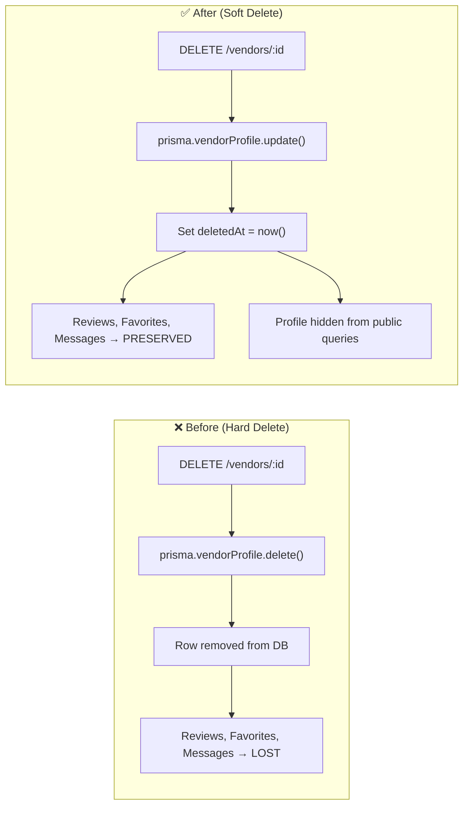
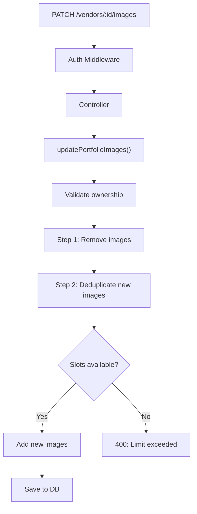

# Soft Delete & Portfolio Image Update — Detailed Report

> [!NOTE]
> This report documents two feature updates made to the VendorProfile module and their impact on existing code.

---

## 1. Problem Statement

### 1A. Hard Delete Issue

The original `delete()` method performed a **hard delete** (`prisma.vendorProfile.delete()`). This is problematic because:

- **Reviews** left by customers on this vendor are orphaned or cascade-deleted.
- **Favorites/wishlists** saved by customers are lost.
- **Conversation and message history** between the vendor and customers is destroyed.
- There is **no recovery path** if a vendor accidentally deletes their profile.

### 1B. Portfolio Image Update Issue

The original `update()` method accepted `portfolioImages` as a full array replacement:

```typescript
// BEFORE: Full array replacement — impractical
...(data.portfolioImages !== undefined && { portfolioImages: data.portfolioImages })
```

This means:
- To **add 1 image**, the client must resend ALL existing images + the new one.
- To **remove 1 image**, the client must resend all images MINUS the one to remove.
- No **max limit** is enforced — a vendor could upload unlimited images.
- If the client sends an **empty array**, all images are wiped.
- This is **error-prone** and requires the client to manage state unnecessarily.

---

## 2. Solution Design

### 2A. Soft Delete



**Schema change:**
```diff
model VendorProfile {
  ...
  createdAt  DateTime @default(now())
  updatedAt  DateTime @updatedAt
+ deletedAt  DateTime?  // Soft-delete timestamp
}
```

**All public queries now include an active filter:**
```typescript
private get activeFilter() {
    return { deletedAt: null };
}
```

This filter is applied to: `findAll()`, `findById()`, `create()` (duplicate check), `update()`, `delete()`, `addService()`, `removeService()`, `getServices()`, and `updatePortfolioImages()`.

**Re-creation after soft delete**: If a user soft-deletes their profile, the duplicate check excludes soft-deleted records, so they can create a new profile.

---

### 2B. Granular Portfolio Image Management



**New endpoint:**

| Method | Endpoint | Body | Description |
|:---|:---|:---|:---|
| `PATCH` | `/api/v1/vendors/:id/images` | `{ add?: string[], remove?: string[] }` | Add/remove portfolio images |

**Key behaviors:**

| Feature | Description |
|:---|:---|
| **Max limit** | `MAX_PORTFOLIO_IMAGES = 10` — enforced server-side |
| **Remove first** | If both `add` and `remove` are provided, removals happen first (frees slots) |
| **Deduplication** | Adding an image that already exists is silently skipped |
| **Error on overflow** | Clear error message: _"Cannot add X image(s). You have Y/10. Only Z slot(s) available."_ |
| **Validation** | At least one of `add` or `remove` must be provided |
| **URL validation** | Each image URL is validated as a proper URL |

**`portfolioImages` removed from `updateVendorSchema`:** Images can ONLY be managed through the dedicated `PATCH /:id/images` endpoint.

---

## 3. Files Changed

| File | Change Type | Summary |
|:---|:---|:---|
| [schema.prisma](file:///d:/work/advert_app/backend/prisma/schema.prisma) | Modified | Added `deletedAt DateTime?` to `VendorProfile` |
| [vendor.schema.ts](file:///d:/work/advert_app/backend/src/modules/vendors/vendor.schema.ts) | Modified | Added `MAX_PORTFOLIO_IMAGES`, `updatePortfolioImagesSchema`; removed `portfolioImages` from `updateVendorSchema` |
| [vendor.service.ts](file:///d:/work/advert_app/backend/src/modules/vendors/vendor.service.ts) | Rewritten | Soft delete, active filter on all queries, new `updatePortfolioImages()` method |
| [vendor.controller.ts](file:///d:/work/advert_app/backend/src/modules/vendors/vendor.controller.ts) | Modified | Added `updatePortfolioImages` handler |
| [vendor.routes.ts](file:///d:/work/advert_app/backend/src/modules/vendors/vendor.routes.ts) | Modified | Added `PATCH /:id/images` route |
| [implementation_plan.md](file:///d:/work/advert_app/backend/docs/vendor_profile/implementation_plan.md) | Modified | Added Phase 2b, updated ERD, API table, test scenarios |
| [task.md](file:///d:/work/advert_app/backend/docs/vendor_profile/task.md) | Modified | Added Phase 2b checklist, new E2E test items |

---

## 4. API Usage Examples

### 4A. Soft Delete

```bash
# Delete (soft) a vendor profile
curl -X DELETE http://localhost:8000/api/v1/vendors/1 \
  -H "Authorization: Bearer <TOKEN>"
# → 204 No Content

# Try to access the deleted profile
curl http://localhost:8000/api/v1/vendors/1
# → 404 Not Found (profile is hidden)

# Listing vendors — deleted profile is NOT included
curl http://localhost:8000/api/v1/vendors
# → 200 OK (deleted vendor excluded from results)

# User can create a new profile (soft-deleted one doesn't block)
curl -X POST http://localhost:8000/api/v1/vendors \
  -H "Authorization: Bearer <TOKEN>" \
  -H "Content-Type: application/json" \
  -d '{"businessName":"New Business", "city":"Addis Ababa", "basePrice":200}'
# → 201 Created
```

### 4B. Portfolio Image Management

```bash
# Add images
curl -X PATCH http://localhost:8000/api/v1/vendors/1/images \
  -H "Authorization: Bearer <TOKEN>" \
  -H "Content-Type: application/json" \
  -d '{"add": ["https://cdn.example.com/img1.jpg", "https://cdn.example.com/img2.jpg"]}'
# → 200 OK (images added)

# Remove specific images
curl -X PATCH http://localhost:8000/api/v1/vendors/1/images \
  -H "Authorization: Bearer <TOKEN>" \
  -H "Content-Type: application/json" \
  -d '{"remove": ["https://cdn.example.com/img1.jpg"]}'
# → 200 OK (image removed)

# Add + Remove in one request (remove happens first)
curl -X PATCH http://localhost:8000/api/v1/vendors/1/images \
  -H "Authorization: Bearer <TOKEN>" \
  -H "Content-Type: application/json" \
  -d '{"add": ["https://cdn.example.com/img3.jpg"], "remove": ["https://cdn.example.com/img2.jpg"]}'
# → 200 OK

# Exceeding max limit
curl -X PATCH http://localhost:8000/api/v1/vendors/1/images \
  -H "Authorization: Bearer <TOKEN>" \
  -H "Content-Type: application/json" \
  -d '{"add": ["https://cdn.example.com/a.jpg", "https://cdn.example.com/b.jpg", ..., "https://cdn.example.com/k.jpg"]}'
# → 400 Bad Request: "Cannot add 11 image(s). You have 1/10 images. Only 9 slot(s) available."
```

---

## 5. Verification

- ✅ **Prisma schema** updated and synced via `prisma db push`
- ✅ **Prisma client** regenerated with `deletedAt` field
- ✅ **TypeScript build** (`npx tsc --noEmit`) passes with **zero errors**
- ✅ **All existing endpoints** remain functional — no breaking changes

---

## 6. E2E Test Scenarios (for Phase 5)

The following test scenarios have been added to the implementation plan and task.md:

### Soft Delete Tests
| # | Scenario | Expected |
|:---|:---|:---|
| 1 | `DELETE /vendors/:id` as owner | `204 No Content` |
| 2 | `GET /vendors/:id` after soft delete | `404 Not Found` |
| 3 | `GET /vendors` after soft delete | Deleted vendor excluded |
| 4 | Create new profile after soft delete | `201 Created` (slot freed) |
| 5 | `DELETE /vendors/:id` as non-owner | `403 Forbidden` |
| 6 | `DELETE /vendors/:id` as admin | `204 No Content` |

### Portfolio Image Tests
| # | Scenario | Expected |
|:---|:---|:---|
| 1 | Add images within limit | `200`, images appended |
| 2 | Remove existing images | `200`, images removed |
| 3 | Add + remove in single request | `200`, remove-first ordering |
| 4 | Exceed `MAX_PORTFOLIO_IMAGES` (10) | `400` with clear error message |
| 5 | Add duplicate images | `200`, duplicates silently skipped |
| 6 | Remove non-existent image | `200`, no change |
| 7 | Neither add nor remove provided | Validation error |
| 8 | Non-owner attempts image update | `403 Forbidden` |
