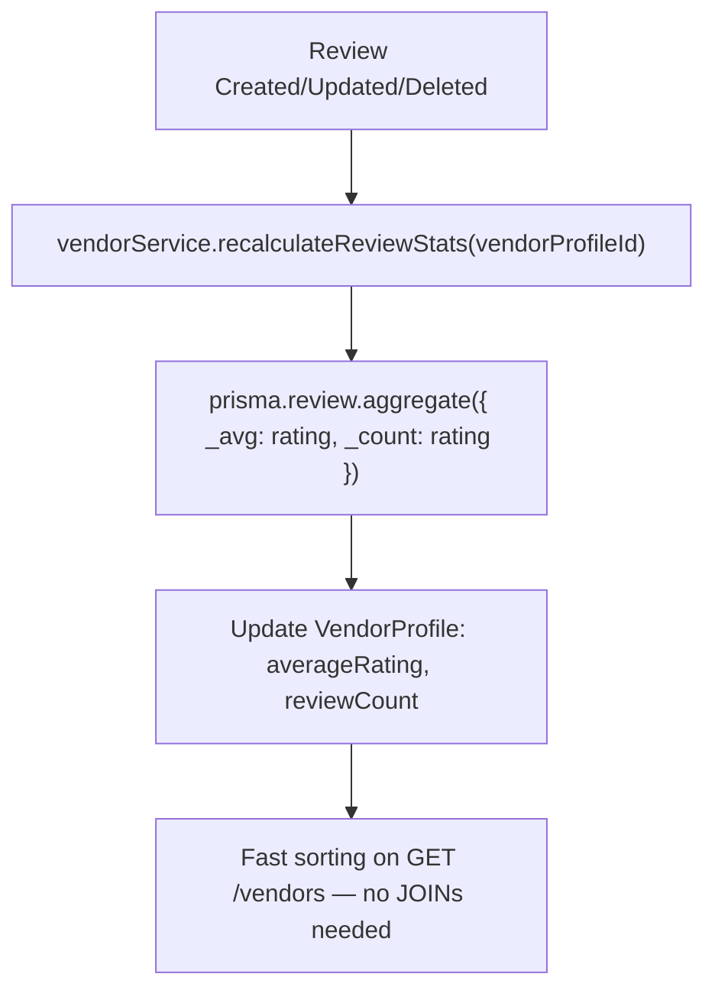

# Sort by Reviews — Implementation Report

> **Feature**: Sort vendor profiles by average rating, review count, and popularity  
> **Date**: 2026-02-20  
> **Status**: ✅ Complete — Build verified (`npx tsc --noEmit` passes)

---

## 1. Problem

Previously, `GET /api/v1/vendors` only supported sorting by `createdAt` and `basePrice`. Professional marketplace apps (Amazon, Airbnb, Fiverr) allow users to sort vendors by review quality — requiring a combination of average rating and review volume.

Computing these dynamically (JOIN + GROUP BY) on every request is expensive. The industry-standard solution is **denormalized fields**.

---

## 2. Approach: Denormalized Review Stats



**Two new fields on `VendorProfile`:**

| Field | Type | Default | Purpose |
|:---|:---|:---|:---|
| `averageRating` | `Float` | `0` | Mean star rating (0.0–5.0), rounded to 1 decimal |
| `reviewCount` | `Int` | `0` | Total number of reviews |

---

## 3. Changes Made

### 3.1 Prisma Schema

**File**: [schema.prisma](file:///d:/work/advert_app/backend/prisma/schema.prisma)

```diff
 model VendorProfile {
   ...
   city                String
   locationCoordinates Json?
+
+  // Denormalized review stats (updated by Review module on create/update/delete)
+  averageRating       Float    @default(0) // Mean star rating (0.0–5.0)
+  reviewCount         Int      @default(0) // Total number of reviews
+
   // Foreign Keys
   ...
 }
```

### 3.2 Migration

**File**: [migration.sql](file:///d:/work/advert_app/backend/prisma/migrations/20260220161900_add_vendor_review_stats/migration.sql)

```sql
ALTER TABLE "VendorProfile" ADD COLUMN "averageRating" DOUBLE PRECISION NOT NULL DEFAULT 0;
ALTER TABLE "VendorProfile" ADD COLUMN "reviewCount" INTEGER NOT NULL DEFAULT 0;
```

> [!NOTE]
> The migration was created manually because the database was offline. Run `npx prisma migrate deploy` when the DB is available to apply it.

### 3.3 Validation Schema

**File**: [vendor.schema.ts](file:///d:/work/advert_app/backend/src/modules/vendors/vendor.schema.ts)

```diff
- sortBy: z.enum(['createdAt', 'basePrice']).optional().default('createdAt'),
+ sortBy: z.enum(['createdAt', 'basePrice', 'averageRating', 'reviewCount', 'popularity']).optional().default('createdAt'),
```

**New sort options:**

| `sortBy` Value | Behavior |
|:---|:---|
| `createdAt` | Sort by creation date (default) |
| `basePrice` | Sort by starting price |
| `averageRating` | Sort by mean star rating |
| `reviewCount` | Sort by number of reviews |
| `popularity` | **Compound**: highest rating first → most reviews as tiebreaker |

### 3.4 Service Logic — `findAll()`

**File**: [vendor.service.ts](file:///d:/work/advert_app/backend/src/modules/vendors/vendor.service.ts)

```typescript
// Build orderBy — 'popularity' uses compound sort, others use single field
const orderBy =
    sortBy === 'popularity'
        ? [{ averageRating: sortOrder }, { reviewCount: sortOrder }]
        : { [sortBy]: sortOrder };
```

When `sortBy=popularity&sortOrder=desc`, Prisma generates:
```sql
ORDER BY "averageRating" DESC, "reviewCount" DESC
```
→ Highest-rated vendors first. If two vendors have the same rating, the one with more reviews wins.

### 3.5 Service Logic — `recalculateReviewStats()`

**File**: [vendor.service.ts](file:///d:/work/advert_app/backend/src/modules/vendors/vendor.service.ts)

```typescript
async recalculateReviewStats(vendorProfileId: number) {
    const stats = await prisma.review.aggregate({
        where: { vendorProfileId },
        _avg: { rating: true },
        _count: { rating: true },
    });

    const averageRating = Math.round((stats._avg.rating ?? 0) * 10) / 10;
    const reviewCount = stats._count.rating;

    await prisma.vendorProfile.update({
        where: { id: vendorProfileId },
        data: { averageRating, reviewCount },
    });

    return { averageRating, reviewCount };
}
```

**Usage (by the Review module):**
```typescript
// After creating a review:
await vendorService.recalculateReviewStats(review.vendorProfileId);

// After deleting a review:
await vendorService.recalculateReviewStats(deletedReview.vendorProfileId);
```

---

## 4. API Usage Examples

**Sort by highest rated:**
```bash
curl "http://localhost:8000/api/v1/vendors?sortBy=averageRating&sortOrder=desc"
```

**Sort by most reviewed:**
```bash
curl "http://localhost:8000/api/v1/vendors?sortBy=reviewCount&sortOrder=desc"
```

**Sort by popularity (rating + reviews combined):**
```bash
curl "http://localhost:8000/api/v1/vendors?sortBy=popularity&sortOrder=desc"
```

**Combine with filters:**
```bash
curl "http://localhost:8000/api/v1/vendors?city=Addis+Ababa&sortBy=popularity&sortOrder=desc&limit=10"
```

---

## 5. Build Verification

```
> npx tsc --noEmit
(no errors — clean build ✅)

> npx prisma generate
✔ Generated Prisma Client (v6.19.2) ✅
```

---

## 6. Integration Notes for Review Module

> [!IMPORTANT]
> When you implement the Review module, call `vendorService.recalculateReviewStats(vendorProfileId)` after **every** review CRUD operation:
> - `createReview()` → recalculate
> - `updateReview()` (if rating changed) → recalculate
> - `deleteReview()` → recalculate
>
> This keeps the denormalized fields in sync without cron jobs or triggers.
